# PRD — Convera

**Project Requirements Document**

| Atribut | Nilai |
|---|---|
| Versi | 0.1 — Draft |
| Tanggal | 2 November 2026 |
| Pemilik dokumen | [isi nama] |
| Status | Menunggu keputusan di bagian 9 (Pertanyaan Terbuka) |
| Sumber utama | Catatan eksplorasi aplikasi referensi, 2 November 2026 |

Convera adalah aplikasi web SaaS yang mengubah percakapan WhatsApp bisnis menjadi event konversi Meta (Contact, Lead, InitiateCheckout, Purchase, dan lainnya) lewat Meta Conversions API, lalu menyajikan hasilnya dalam dashboard funnel, log event, dan laporan iklan.

### Cara membaca dokumen ini

- **[asumsi]** menandai perilaku atau kebutuhan yang tidak terlihat langsung di catatan eksplorasi: tebakan yang memang sudah bertanda asumsi di catatan, atau keputusan desain baru yang memengaruhi perilaku bisnis. Semuanya perlu dikonfirmasi.
- Bagian tanpa tanda berasal dari hal yang terlihat di UI aplikasi referensi atau dari halaman panduan di dalam aplikasi referensi.
- Detail teknis turunan (nama tabel, tipe kolom, path endpoint, nama komponen) adalah usulan untuk stack yang dipilih dan tidak ditandai, kecuali menyangkut perilaku bisnis.
- Semua angka target di Kebutuhan Non-Fungsional adalah [asumsi].
- Semua nama, label, dan teks UI di dokumen ini ditulis ulang; tidak ada brand, logo, atau teks yang disalin dari aplikasi referensi. Nama platform Meta, Facebook, Instagram, dan WhatsApp disebut karena merupakan dependensi fungsional. Provider WhatsApp Business API pihak ketiga sengaja tidak disebut namanya (lihat Pertanyaan Terbuka).

### Stack

| Lapisan | Teknologi |
|---|---|
| Frontend | Next.js (App Router) + TypeScript |
| UI | Tailwind CSS + shadcn/ui (grafik memakai komponen chart shadcn/ui berbasis Recharts) |
| Backend | Go + Gin (REST API) dan worker Go untuk job asinkron |
| Database | PostgreSQL |

### Daftar isi

1. [Overview](#1-overview)
2. [Requirements](#2-requirements)
3. [Core Features](#3-core-features)
4. [User Flow](#4-user-flow)
5. [Architecture](#5-architecture)
6. [Database Schema](#6-database-schema)
7. [API Contract](#7-api-contract)
8. [Halaman & Komponen UI](#8-halaman--komponen-ui)
9. [Pertanyaan Terbuka](#9-pertanyaan-terbuka)

---

## 1. Overview

### 1.1 Tujuan Produk

1. Menyambungkan konversi yang terjadi di chat WhatsApp ke sistem optimasi iklan Meta, sehingga algoritma iklan belajar dari calon pembeli dan pembeli nyata, bukan hanya dari klik atau pesan masuk.
2. Memberi pemilik bisnis dan pengiklan gambaran funnel yang jelas: berapa kontak masuk, lead, checkout, pembelian, dan revenue per periode, serta iklan mana yang menghasilkannya.
3. Bisa disiapkan tanpa coding: cukup isi Pixel ID dan token, tempel Webhook URL di provider WhatsApp, lalu atur aturan kapan sebuah event dikirim.
4. Menyediakan laporan yang siap dibagikan ke klien (rekap harian per bulan, laporan per iklan).

**Ukuran keberhasilan [asumsi]**

| Metrik | Target awal |
|---|---|
| Waktu dari registrasi sampai event pertama berstatus sukses | median < 30 menit |
| Persentase event terkirim sukses ke Meta | ≥ 95% |
| Proyek trial yang menerima ≥ 1 event dalam 7 hari | ≥ 60% |
| Konversi trial ke berbayar | ≥ 15% |

### 1.2 Target User

| Persona | Gambaran | Kebutuhan utama |
|---|---|---|
| Pemilik bisnis / UMKM | Beriklan Click-to-WhatsApp atau landing page di Meta; bisnis di salah satu dari 9 kategori (umum, kesehatan, e-commerce, pendidikan, properti, F&B, jasa, travel, keuangan) | Tahu iklan mana yang menghasilkan pembeli, setup sederhana |
| Digital marketer / agency [asumsi] | Mengelola beberapa bisnis sekaligus, membuat laporan bulanan untuk klien | Banyak proyek dalam satu akun, laporan harian/bulanan, export CSV |
| Admin Convera (internal) | Tim operasional aplikasi | Verifikasi pembayaran manual, kelola harga, rekening tujuan, dan pengumuman |

Pembagian persona di atas adalah [asumsi]; dasarnya adalah kategori bisnis di form pengaturan, fitur multi-proyek, dan laporan yang ditujukan untuk klien.

### 1.3 Masalah yang Diselesaikan

1. **Konversi tidak terlihat oleh Meta.** Transaksi terjadi di chat WhatsApp, sehingga Meta hanya tahu ada klik atau pesan. Iklan akhirnya dioptimasi ke orang yang suka mengirim pesan, bukan yang membeli.
2. **Upload konversi manual itu lambat dan rawan salah.** Mengumpulkan nomor pembeli lalu mengunggahnya sebagai konversi offline memakan waktu dan sering terlambat.
3. **Atribusi putus.** Jejak dari iklan → landing page → WhatsApp hilang, sehingga sulit tahu iklan mana yang membawa penjualan.
4. **ROAS sulit dihitung.** Spend ada di Ads Manager, penjualan ada di chat; tidak ada satu tempat yang menggabungkan keduanya.
5. **Data tercemar.** Nomor CS, karyawan, vendor, atau spam ikut terhitung sebagai lead.
6. **Kualitas lead tidak terukur.** Tidak ada cara sederhana untuk menilai seberapa "panas" sebuah percakapan.

### 1.4 In-Scope

| Fase | Cakupan |
|---|---|
| Fase 1 (MVP) | Autentikasi & akun, manajemen proyek, konfigurasi Meta CAPI & koneksi WhatsApp (WABA via webhook), event mapping, pipeline webhook → Meta CAPI, Event Log, blacklist, dashboard KPI |
| Fase 2 | Lead scoring & chat minimum, tracker landing page, dashboard analitik (tren, distribusi, funnel, insight, label KPI kustom), export CSV |
| Fase 3 | Trial & langganan per proyek, pembayaran transfer manual, panel admin, banner pengumuman |
| Fase 4 | Koneksi Meta Ads (OAuth) & Data Iklan, laporan bulanan, laporan iklan Click-to-WhatsApp & landing page |
| Fase 5 | Saran keyword dari percakapan, koneksi WhatsApp via scan QR, tema terang/gelap, panduan in-app |

### 1.5 Out-of-Scope

- Inbox atau CRM WhatsApp (membaca dan membalas chat di dalam aplikasi). Aplikasi hanya menerima webhook.
- Mengirim pesan WhatsApp, broadcast, atau chatbot.
- Membuat atau mengubah kampanye iklan; integrasi Meta Ads hanya membaca data.
- Platform iklan selain Meta (Google Ads, TikTok Ads, dan lainnya) [asumsi].
- Payment gateway otomatis; pembayaran langganan memakai transfer manual dulu [asumsi].
- Aplikasi mobile native; aplikasi web dibuat responsif.
- Banyak user atau tim per proyek; satu proyek dimiliki satu akun [asumsi].
- Menyimpan isi pesan WhatsApp.
- Multi-bahasa; antarmuka hanya Bahasa Indonesia [asumsi].
- Konsep "cabang" yang terlihat sebagai sisa fitur lama di aplikasi referensi (lihat Pertanyaan Terbuka).

### 1.6 Glosarium

| Istilah | Arti |
|---|---|
| Proyek | Satu bisnis/brand yang dilacak. Punya Pixel, koneksi WhatsApp, aturan event, dan data sendiri |
| Meta CAPI | Meta Conversions API, endpoint server-to-server untuk mengirim event konversi ke Pixel/dataset |
| Pixel ID | ID dataset/Pixel Meta tujuan event |
| Test Event Code | Kode dari Meta Events Manager untuk menguji event tanpa masuk ke data produksi |
| WABA | WhatsApp Business API (resmi), biasanya lewat provider pihak ketiga yang mengirim webhook |
| CTWA | Iklan Click-to-WhatsApp |
| `ctwa_clid` | ID klik dari iklan CTWA yang ikut di payload pesan pertama; dipakai Meta untuk atribusi |
| `fbclid` / `fbc` | ID klik dari iklan ke landing page / format cookie klik Meta yang dikirim ke CAPI |
| Slot event | Satu aturan: event Meta apa yang dikirim, kapan, dari pesan siapa, dan berapa nilainya |
| Event bernilai | Event yang membawa nilai uang: Purchase, AddPaymentInfo, AddToCart, AddToWishlist, StartTrial, Subscribe, Custom Event |
| Scoring | Penjumlahan skor keyword per nomor; event dikirim saat skor mencapai threshold |
| Customer / CS | Arah pesan: dari calon pembeli (masuk) / dari pihak bisnis (keluar) |
| Blacklist | Daftar nomor yang tidak boleh memicu event |
| Kode referensi | Kode unik yang disisipkan tracker ke teks pesan WhatsApp dari landing page untuk menghubungkan nomor dengan kunjungan |

---

## 2. Requirements

### 2.1 Kebutuhan Fungsional

**Autentikasi & Akun**

| ID | Kebutuhan | Fase |
|---|---|---|
| FR-01 | User dapat mendaftar dengan nama, email, nomor HP, dan password (minimal 8 karakter [asumsi]; referensi menyebut minimal 6). Email harus unik. | 1 |
| FR-02 | User dapat masuk dengan email dan password, dan keluar. Sesi disimpan di cookie httpOnly. | 1 |
| FR-03 | User dapat meminta tautan reset password lewat email; tautan berlaku 60 menit dan sekali pakai [asumsi: mekanisme email]. | 1 |
| FR-04 | User dapat melihat info akun: nama, email, nomor HP, role (read-only). | 1 |
| FR-05 | User dapat mengganti password dengan memasukkan password lama dan password baru; sesi di perangkat lain dicabut [asumsi]. | 1 |
| FR-06 | Sistem punya role `user` dan `admin`; fitur admin hanya bisa diakses role `admin` [asumsi: panel admin tidak terlihat dari akun user]. | 1 |

**Manajemen Proyek**

| ID | Kebutuhan | Fase |
|---|---|---|
| FR-07 | User dapat membuat proyek cukup dengan nama. Slug dibuat otomatis (huruf kecil, karakter non-alfanumerik menjadi `-`, `-` di awal/akhir dibuang) dan pratinjaunya tampil langsung saat mengetik. | 1 |
| FR-08 | Slug unik secara global dan tidak berubah setelah proyek dibuat; jika bentrok, sistem menambah sufiks angka [asumsi]. | 1 |
| FR-09 | User dapat melihat semua proyeknya (di sidebar dan halaman kelola) beserta nama, slug, status aktif, kategori bisnis, jenis koneksi/provider WhatsApp, dan Webhook URL dengan tombol salin. | 1 |
| FR-10 | User dapat mengubah nama dan kategori bisnis proyek. | 1 |
| FR-11 | User dapat menonaktifkan dan mengaktifkan kembali proyek; proyek nonaktif tidak memproses webhook maupun tracker [asumsi]. | 1 |
| FR-12 | User dapat menghapus proyek secara permanen beserta seluruh datanya setelah konfirmasi. | 1 |
| FR-13 | Setiap akses data proyek diverifikasi kepemilikannya; proyek yang tidak ada atau milik user lain menghasilkan 404. | 1 |

**Konfigurasi Meta CAPI & WhatsApp**

| ID | Kebutuhan | Fase |
|---|---|---|
| FR-14 | User dapat menyimpan Pixel ID (hanya angka; batas panjang lihat Pertanyaan Terbuka), Access Token CAPI (rahasia, ditampilkan tersamar), dan Test Event Code (opsional). | 1 |
| FR-15 | User dapat memilih jenis koneksi WhatsApp (`waba`; `qr` tersedia di Fase 5) dan provider WABA (adapter per provider + mode generik). | 1 |
| FR-16 | Sistem menampilkan Webhook URL unik per proyek beserta tombol salin dan petunjuk setup yang berubah sesuai provider. | 1 |
| FR-17 | User dapat menyimpan Webhook Secret dari provider, atau meminta sistem membuatkannya (mode generik), untuk verifikasi signature/HMAC-SHA256. Secret tidak pernah ditampilkan ulang secara utuh. | 1 |
| FR-18 | User dapat menguji koneksi CAPI: sistem mengirim event uji dan menampilkan jawaban Meta [asumsi: fitur baru, tidak ada di referensi]. | 1 |
| FR-19 | User dapat memilih kategori bisnis (9 opsi) yang menentukan keyword default untuk scoring mode Auto. | 1 |

**Event Mapping**

| ID | Kebutuhan | Fase |
|---|---|---|
| FR-20 | User dapat mengelola daftar slot event berurutan (tambah, hapus, ubah urutan). Urutan slot adalah urutan funnel. Semua slot disimpan sekaligus. | 1 |
| FR-21 | Setiap slot memilih salah satu dari 16 event standar Meta, atau Custom Event dengan nama sendiri, atau dibuat tidak aktif. | 1 |
| FR-22 | Setiap slot punya keyword trigger opsional (kosong berarti semua pesan); pencocokan tidak membedakan huruf besar/kecil [asumsi untuk keyword trigger]. | 1 |
| FR-23 | Setiap slot punya filter pengirim: Customer, CS, atau Keduanya (default Keduanya). | 1 |
| FR-24 | Untuk event bernilai, user memilih cara mengambil nilai: otomatis (angka terbesar di pesan), angka setelah keyword, atau nilai tetap. | 1 |
| FR-25 | Setiap slot punya "chat minimum": jumlah pesan minimum dari nomor tersebut sebelum slot boleh memicu event. | 2 |

**Pipeline Webhook → Meta CAPI**

| ID | Kebutuhan | Fase |
|---|---|---|
| FR-26 | Sistem menyediakan endpoint webhook publik per proyek yang menerima pesan masuk dan keluar, memverifikasi signature, dan membalas cepat; pengiriman ke Meta dilakukan asinkron. | 1 |
| FR-27 | Sistem menormalisasi payload per provider; mode generik mengenali field `phone`, `from`, `name`, `text`, `message`, `body`, `content`. | 1 |
| FR-28 | Pesan dari atau ke nomor blacklist diabaikan (tidak membuat kontak, log pesan, maupun event). | 1 |
| FR-29 | Sistem menentukan arah pesan (customer atau CS). Kontak baru hanya dibuat saat customer mengirim pesan pertama. Nomor dinormalisasi ke format 62xxx. | 1 |
| FR-30 | Sistem mengambil atribusi: `ctwa_clid` dari payload CTWA → sumber Ads + platform + ID/nama iklan; tanpa data atribusi → Organik. | 1 |
| FR-31 | Sistem mengevaluasi slot sesuai urutan dan membuat event bila semua syarat terpenuhi. Event non-bernilai dikirim maksimal sekali per nomor per event; event bernilai boleh berulang per pesan pemicu yang berbeda [asumsi, lihat Pertanyaan Terbuka]. | 1 |
| FR-32 | Sistem mengirim event ke Meta CAPI dengan data pengguna ter-hash SHA-256, data atribusi (`ctwa_clid`/`fbc`), value dan mata uang, `event_id` untuk deduplikasi, dan Test Event Code bila diisi. | 1 |
| FR-33 | Sistem mencatat setiap event (pending/success/failed, pesan error, jawaban Meta). Kegagalan sementara di-retry otomatis dengan backoff, maksimal 5 kali [asumsi]. | 1 |
| FR-34 | Isi pesan tidak disimpan; yang disimpan hanya metadata (waktu, arah, ID pesan provider). | 1 |

**Event Log**

| ID | Kebutuhan | Fase |
|---|---|---|
| FR-35 | User dapat melihat event proyek, terbaru di atas, dengan filter periode (hari ini, kemarin, 7 hari, 30 hari, rentang kustom) dan jenis event, dengan paginasi [asumsi: referensi membatasi 200 baris tanpa paginasi]. | 1 |
| FR-36 | Kolom: waktu, nomor HP, nama profil WhatsApp, sumber, platform, iklan, event, trigger, value, status (+ pesan error), dan kualitas lead (Fase 2). | 1 |
| FR-37 | User dapat memuat ulang tabel dan mengirim ulang event yang gagal secara manual [asumsi: kirim ulang manual tidak ada di referensi]. | 1 |
| FR-38 | User dapat memasukkan nomor ke blacklist langsung dari baris log. | 1 |

**Blacklist**

| ID | Kebutuhan | Fase |
|---|---|---|
| FR-39 | User dapat menambah nomor ke blacklist (wajib, divalidasi dan dinormalisasi ke 62 + 8–13 digit [asumsi]) dengan alasan opsional. | 1 |
| FR-40 | User dapat melihat jumlah dan daftar nomor blacklist, serta menghapus nomor dari blacklist [asumsi: aksi hapus belum terlihat di referensi]. | 1 |

**Dashboard**

| ID | Kebutuhan | Fase |
|---|---|---|
| FR-41 | Dashboard menampilkan kartu KPI Contact, Lead, InitiateCheckout, Purchase (jumlah nomor unik) serta revenue dan jumlah closing, dengan filter 10 preset periode + rentang kustom (minggu dimulai Senin, zona waktu Asia/Jakarta). Dashboard juga menampilkan checklist setup untuk proyek yang belum lengkap [asumsi]. | 1 |
| FR-42 | User dapat mengubah label kartu KPI per proyek (1–24 karakter). | 2 |
| FR-43 | Dashboard menampilkan tren harian 7/14/30 hari (4 seri, bisa disembunyikan per seri) dan perbandingan minggu ini vs minggu lalu. | 2 |
| FR-44 | Dashboard menampilkan distribusi event dan funnel konversi dengan persentase antar tahap [asumsi: persentase]. | 2 |
| FR-45 | Dashboard menampilkan insight 30 hari: porsi Purchase dari iklan, jam paling aktif, dan 5 customer teratas berdasarkan revenue [asumsi: dasar pengurutan]. | 2 |
| FR-46 | Dashboard menampilkan tabel performa iklan teratribusi untuk periode terpilih; klik baris membuka detail iklan [asumsi: isi detail]. | 2 |

**Lead Scoring**

| ID | Kebutuhan | Fase |
|---|---|---|
| FR-47 | User dapat mengaktifkan scoring per slot: mode Auto (keyword default sesuai kategori bisnis) atau Manual (daftar keyword + skor, default 10), dengan threshold 1–9999. | 2 |
| FR-48 | Skor terakumulasi per nomor per slot; event dikirim sekali saat skor ≥ threshold. | 2 |
| FR-49 | Scoring tidak dapat diaktifkan pada slot dengan pengirim CS. | 2 |
| FR-50 | Sistem menghitung kualitas lead: Hot (skor ≥ 2× threshold), Warm (skor ≥ threshold), Cold (di bawah threshold). | 2 |

**Tracker Landing Page**

| ID | Kebutuhan | Fase |
|---|---|---|
| FR-51 | Sistem menyediakan snippet script tracker per proyek dengan tombol salin dan langkah verifikasi. | 2 |
| FR-52 | Tracker mencatat sesi landing page (fbclid, URL, UTM), mengirim ViewContent, dan menyisipkan kode referensi unik ke teks pesan pada link WhatsApp (`wa.me` dan `api.whatsapp.com/send`). | 2 |
| FR-53 | Pipeline membaca kode referensi di pesan masuk, menghubungkan nomor dengan sesi landing page, dan memakai fbc/IP/user agent dari sesi tersebut untuk event berikutnya. | 2 |

**Export**

| ID | Kebutuhan | Fase |
|---|---|---|
| FR-54 | User dapat mengekspor Event Log ke CSV sesuai filter aktif (dibuat di server). | 2 |
| FR-55 | User dapat mengekspor tabel performa iklan dashboard dan laporan bulanan ke CSV. | 2 (dashboard), 4 (laporan) |

**Langganan & Pembayaran**

| ID | Kebutuhan | Fase |
|---|---|---|
| FR-56 | Proyek baru otomatis mendapat trial 7 hari; banner menampilkan sisa waktu dan tombol upgrade. | 3 |
| FR-57 | Saat trial atau langganan habis, proyek terkunci; detail perilaku terkunci [asumsi] (lihat Pertanyaan Terbuka). | 3 |
| FR-58 | User dapat memilih durasi langganan 1, 3, 6, atau 12 bulan; total dan persentase hemat dihitung dari tabel harga. | 3 |
| FR-59 | User melihat instruksi transfer (bank, nomor rekening + salin, atas nama, total), dapat mengunggah bukti (JPG/PNG/PDF ≤ 5 MB, opsional), dan dapat membuka konfirmasi via WhatsApp admin dengan pesan terisi otomatis. | 3 |
| FR-60 | User dapat melihat riwayat pengajuan pembayaran per proyek beserta status dan catatan admin [asumsi]. | 3 |

**Admin**

| ID | Kebutuhan | Fase |
|---|---|---|
| FR-61 | Admin dapat melihat, memverifikasi, atau menolak pengajuan pembayaran; verifikasi memperpanjang masa aktif proyek sesuai durasi [asumsi]. | 3 |
| FR-62 | Admin dapat mengelola harga per durasi, rekening tujuan, dan nomor WhatsApp admin [asumsi]. | 3 |
| FR-63 | Admin dapat mengelola pengumuman global; user melihat pengumuman aktif sebagai banner di semua halaman [asumsi: dikelola admin]. | 3 |

**Meta Ads & Laporan**

| ID | Kebutuhan | Fase |
|---|---|---|
| FR-64 | User dapat menghubungkan akun Meta Ads lewat Facebook Login (OAuth), memilih satu ad account per proyek, dan memutus koneksi. | 4 |
| FR-65 | Sistem menyinkronkan insight harian (spend, impresi [asumsi], klik) per campaign/adset/iklan secara terjadwal dan manual. | 4 |
| FR-66 | Halaman Data Iklan menampilkan spend, klik, event WhatsApp, CPL, dan ROAS per campaign/adset/iklan. | 4 |
| FR-67 | Laporan bulanan per hari (tab 6 bulan terakhir): Total Klik WA, Klik WA Unik, Purchase, Spend, Revenue, ROAS, baris total, dan analisis customer. | 4 |
| FR-68 | Laporan iklan Click-to-WhatsApp: KPI, perbandingan dengan periode sebelumnya yang sama panjang, ringkasan penjualan total vs dari channel, tabel per iklan yang bisa diurutkan, dan tren harian. | 4 |
| FR-69 | Laporan iklan landing page: sama seperti FR-68 ditambah jumlah sesi landing page. | 4 |

**Lanjutan**

| ID | Kebutuhan | Fase |
|---|---|---|
| FR-70 | Sistem menyarankan keyword yang dipelajari dari pesan customer beserta persentase yang akhirnya Purchase; user dapat menerapkan saran ke slot atau mengabaikannya [asumsi: bentuk saran]. | 5 |
| FR-71 | User dapat menghubungkan WhatsApp lewat scan QR (gateway) dan melihat status koneksi. | 5 |
| FR-72 | User dapat memilih tema terang/gelap; pilihan disimpan di browser. | 5 |
| FR-73 | Aplikasi memiliki halaman panduan in-app dengan daftar isi. | 5 |

### 2.2 Kebutuhan Non-Fungsional

| ID | Kategori | Kebutuhan | Target / Ukuran |
|---|---|---|---|
| NFR-01 | Performa | Waktu balas endpoint webhook | p95 < 300 ms |
| NFR-02 | Performa | Latensi dari pesan diterima sampai event berstatus success | p95 < 10 detik |
| NFR-03 | Performa | Endpoint baca (dashboard, log, laporan) | p95 < 800 ms untuk proyek dengan ≤ 500 ribu event dalam 90 hari |
| NFR-04 | Performa | Halaman web | LCP < 2,5 detik dan INP < 200 ms di jaringan 4G |
| NFR-05 | Performa | Kapasitas webhook | ≥ 100 request/detik per instance API; API stateless agar bisa diskalakan horizontal |
| NFR-06 | Performa | Script tracker | ≤ 8 KB gzip, dimuat `async`, tidak memblokir render, gagal diam bila API tidak terjangkau |
| NFR-07 | Keamanan | Autentikasi | Password di-hash argon2id; access token JWT 15 menit + refresh token 30 hari di cookie httpOnly, Secure, SameSite=Lax; refresh token di-rotate dan disimpan ter-hash |
| NFR-08 | Keamanan | Otorisasi | Setiap endpoint proyek memeriksa kepemilikan di query (`WHERE slug = $1 AND user_id = $2`) untuk mencegah BOLA/IDOR; middleware khusus admin; resource milik user lain dijawab 404 |
| NFR-09 | Keamanan | Data rahasia | Access Token CAPI, Webhook Secret, dan token Meta Ads dienkripsi AES-256-GCM (kunci dari env/KMS); API hanya mengembalikan versi tersamar; tidak pernah ditulis ke log |
| NFR-10 | Keamanan | Webhook | Verifikasi HMAC-SHA256/secret dengan perbandingan constant-time; URL memakai `webhook_key` acak (bukan slug); body maksimal 1 MB; idempoten per `provider_message_id` |
| NFR-11 | Keamanan | Input & web | Validasi di server (validator Go) dan di client (zod); query SQL terparameter; header CSP, HSTS, X-Content-Type-Options, Referrer-Policy; CSRF double-submit token untuk request mutasi; CORS hanya untuk domain frontend kecuali endpoint tracker publik |
| NFR-12 | Keamanan | Rate limit | Login 5 percobaan/15 menit per IP+email; lupa password 3/jam per email; tracker 60 request/menit per IP; webhook 1.000 request/menit per proyek |
| NFR-13 | Keamanan | Upload file | Bukti transfer dicek magic bytes (JPG/PNG/PDF), maksimal 5 MB, nama file acak, disimpan di storage privat, diakses lewat URL bertanda tangan berumur pendek (≤ 5 menit) |
| NFR-14 | Privasi | Data pribadi | Isi pesan tidak disimpan; nomor dan data pengguna di-hash SHA-256 sebelum dikirim ke Meta; retensi `message_logs` 180 hari; mengikuti UU Pelindungan Data Pribadi |
| NFR-15 | Keandalan | Pengiriman event | Retry dengan backoff 1, 5, 15, 60, 240 menit untuk error sementara (5xx, timeout, rate limit); `event_id` unik mencegah duplikasi di Meta; uptime layanan 99,5% per bulan |
| NFR-16 | Responsif | Tata letak | Mobile-first, berfungsi mulai lebar 360 px; breakpoint Tailwind `sm` 640, `md` 768, `lg` 1024; sidebar menjadi drawer (Sheet) di bawah 1024 px; tabel lebar di-scroll horizontal di dalam kontainernya sendiri atau tampil sebagai kartu di bawah 768 px; target sentuh ≥ 44×44 px |
| NFR-17 | Aksesibilitas | Standar | WCAG 2.1 level AA: kontras teks ≥ 4.5:1 di kedua tema; seluruh fitur bisa dipakai dengan keyboard dan fokus selalu terlihat; tombol ikon (salin, tampilkan rahasia) punya `aria-label`; status tidak hanya dibedakan warna (badge selalu berteks); grafik punya ringkasan teks atau tabel alternatif; konfirmasi dan ubah label memakai Dialog shadcn/ui, bukan `prompt()`/`alert()`; pesan error form ditautkan dengan `aria-describedby`; menghormati `prefers-reduced-motion` |
| NFR-18 | Lokalisasi & waktu | Format | Bahasa Indonesia; format Rupiah (Rp 1.250.000); timestamp disimpan UTC (`timestamptz`), agregasi dan tampilan memakai Asia/Jakarta (WIB); minggu dimulai Senin |
| NFR-19 | Observabilitas | Monitoring | Log JSON terstruktur dengan `request_id`; metrik jumlah webhook, event per status, latensi CAPI; alert bila rasio event gagal > 10% dalam 15 menit |
| NFR-20 | Maintainability | Kualitas kode | Spesifikasi OpenAPI 3 sesuai bagian 7; migrasi database berversi; unit test untuk normalisasi payload, pencocokan slot, scoring, dan ekstraksi nilai dengan cakupan ≥ 80%; tipe TypeScript di-generate dari OpenAPI |
| NFR-21 | Kompatibilitas | Browser | Dua versi terakhir Chrome, Edge, Firefox, dan Safari (desktop dan mobile) |

---

## 3. Core Features

### Ringkasan fase

| Fase | Fokus | Hasil akhir fase |
|---|---|---|
| Fase 1 | MVP | User bisa daftar, membuat proyek, menghubungkan WhatsApp dan Meta, lalu event konversi terkirim otomatis dan terpantau di dashboard serta Event Log |
| Fase 2 | Kualitas lead & analitik | Lead lebih akurat (scoring, chat minimum), atribusi landing page, analitik lengkap, export CSV |
| Fase 3 | Monetisasi | Trial, langganan berbayar per proyek, verifikasi pembayaran oleh admin |
| Fase 4 | Integrasi iklan & laporan | Spend dari Meta Ads, ROAS, laporan bulanan dan laporan per iklan |
| Fase 5 | Lanjutan | Saran keyword, koneksi QR, tema, panduan |

### Fase 1 — Autentikasi & Akun (Prioritas: Tinggi)

**Deskripsi.** User mendaftar, masuk, keluar, memulihkan password lewat email, melihat info akun, dan mengganti password. Role `admin` sudah ada sejak awal agar Fase 3 tidak perlu migrasi besar.

**FR terkait:** FR-01, FR-02, FR-03, FR-04, FR-05, FR-06

**Acceptance criteria**
1. Registrasi dengan email yang sudah terdaftar menampilkan error di field email dan tidak membuat akun.
2. Setelah registrasi berhasil, user langsung masuk dan diarahkan ke halaman Proyek [asumsi].
3. Login gagal menampilkan pesan umum yang tidak membocorkan apakah email terdaftar; percobaan ke-6 dalam 15 menit dari IP+email yang sama dijawab 429.
4. Permintaan reset password selalu menampilkan pesan sukses yang sama, terdaftar atau tidak; tautan reset kedaluwarsa setelah 60 menit dan tidak bisa dipakai dua kali.
5. Ganti password gagal jika password lama salah; jika berhasil, semua sesi lain dicabut dan sesi saat ini tetap aktif.
6. User role `user` yang membuka route `/admin/*` melihat halaman 403, dan endpoint `/api/v1/admin/*` menjawab 403.

### Fase 1 — Manajemen Proyek (Prioritas: Tinggi)

**Deskripsi.** Satu akun bisa punya banyak proyek. Proyek dibuat dari dialog di sidebar atau halaman Kelola Proyek, cukup dengan nama. Saat dibuat, sistem menyiapkan slug, `webhook_key` acak, slot event default, dan (mulai Fase 3) masa trial. Halaman Kelola Proyek menampilkan kartu per proyek dengan aksi Pengaturan, Event Log, Nonaktifkan/Aktifkan, dan Hapus.

**FR terkait:** FR-07, FR-08, FR-09, FR-10, FR-11, FR-12, FR-13

**Acceptance criteria**
1. Mengetik nama "Toko Dummy & Co. 2026!" menampilkan pratinjau slug `toko-dummy-co-2026` sebelum disimpan.
2. Nama kosong atau lebih dari 100 karakter ditolak di client dan di server.
3. Proyek baru langsung muncul di sidebar dan di Kelola Proyek, lalu user diarahkan ke halaman Pengaturan proyek tersebut.
4. Jika slug sudah dipakai, sistem memakai `-2`, `-3`, dan seterusnya; slug final ditampilkan setelah proyek dibuat [asumsi].
5. Menonaktifkan proyek meminta konfirmasi singkat [asumsi: referensi langsung submit tanpa konfirmasi]; setelah nonaktif, webhook dijawab 200 tetapi tidak diproses.
6. Menghapus proyek mewajibkan user mengetik ulang nama proyek di dialog konfirmasi [asumsi], lalu menghapus semua data turunan (kontak, event, slot, blacklist, sesi landing page, insight iklan).
7. Membuka slug yang tidak ada atau milik user lain menampilkan halaman 404, bukan 403, agar keberadaan proyek tidak bocor.

### Fase 1 — Konfigurasi Meta CAPI & Koneksi WhatsApp (Prioritas: Tinggi)

**Deskripsi.** Halaman Pengaturan proyek menyatukan semua konfigurasi dalam beberapa kartu yang disimpan bersama: info proyek (nama, kategori bisnis), Meta CAPI (Pixel ID, Access Token, Test Event Code), dan koneksi WhatsApp (jenis koneksi, provider, Webhook URL, Webhook Secret). Petunjuk webhook berubah sesuai provider. Mode generik menampilkan daftar field payload yang dikenali dan peringatan bahwa atribusi iklan serta deteksi arah pesan bisa tidak lengkap. Tombol "Uji koneksi" mengirim satu event uji ke Meta [asumsi].

**FR terkait:** FR-10, FR-14, FR-15, FR-16, FR-17, FR-18, FR-19

**Acceptance criteria**
1. Pixel ID yang berisi selain angka atau panjangnya di luar batas ditolak dengan pesan error di bawah field.
2. Setelah disimpan, Access Token hanya tampil tersamar (4 karakter terakhir). Membiarkan field token kosong saat menyimpan tidak menghapus token lama.
3. Webhook URL bisa disalin dengan satu klik dan muncul notifikasi "Tersalin" yang juga dibacakan screen reader.
4. Panel petunjuk berubah sesuai provider yang dipilih tanpa reload.
5. Webhook Secret yang dibuat sistem hanya ditampilkan sekali di dialog dengan tombol salin; setelah dialog ditutup hanya status "tersimpan" yang terlihat.
6. "Uji koneksi" mengirim event uji memakai Test Event Code dan menampilkan jumlah event yang diterima Meta atau pesan error dari Meta. Jika Pixel ID atau token belum diisi, tombol dinonaktifkan dengan keterangan.
7. Meninggalkan halaman dengan perubahan yang belum disimpan memunculkan peringatan [asumsi].

### Fase 1 — Event Mapping (Prioritas: Tinggi)

**Deskripsi.** Kartu Event Mapping berisi daftar slot. Setiap slot menentukan event Meta yang dikirim (16 event standar atau Custom Event), keyword trigger, filter pengirim, dan cara mengambil nilai untuk event bernilai. Urutan slot adalah urutan funnel (Contact → Lead → InitiateCheckout → Purchase). Event standar yang bisa dipilih: Contact, Lead, InitiateCheckout, Purchase, CompleteRegistration, AddToCart, AddToWishlist, AddPaymentInfo, Search, ViewContent, Subscribe, StartTrial, SubmitApplication, Schedule, FindLocation, CustomizeProduct.

Aturan pengambilan nilai:
- **Otomatis**: ambil angka terbesar di teks pesan. Format Indonesia didukung: `1.250.000`, `1,25 jt`, `250rb`, `250k` [asumsi untuk singkatan].
- **Angka setelah keyword**: ambil angka pertama tepat setelah keyword trigger yang cocok.
- **Nilai tetap**: selalu memakai nominal yang diisi.

**FR terkait:** FR-20, FR-21, FR-22, FR-23, FR-24

**Acceptance criteria**
1. User bisa menambah, menghapus, dan mengubah urutan slot (drag-and-drop dan tombol naik/turun untuk keyboard); perubahan baru permanen setelah disimpan.
2. Memilih Custom Event memunculkan field nama event yang wajib diisi (huruf, angka, underscore, maksimal 50 karakter [asumsi]).
3. Pilihan cara mengambil nilai hanya muncul untuk event bernilai; mode nilai tetap mewajibkan nominal > 0.
4. Proyek baru mendapat slot default: Contact aktif (semua pesan pertama dari customer), serta Lead, InitiateCheckout, dan Purchase dalam keadaan tidak aktif sebagai templat [asumsi].
5. Penyimpanan bersifat atomik: jika satu slot tidak valid, tidak ada perubahan yang tersimpan dan error ditampilkan di slot yang bersangkutan.
6. Slot yang sudah pernah memicu event tetap mempertahankan ID-nya saat diedit, sehingga riwayat event tetap terhubung.

### Fase 1 — Pipeline Webhook ke Meta CAPI (Prioritas: Tinggi)

**Deskripsi.** Inti sistem. Saat provider mengirim webhook, API memverifikasi signature, menormalisasi payload, mengecek blacklist, menentukan arah pesan, membuat atau memperbarui kontak beserta atribusinya, menyimpan metadata pesan, lalu mengevaluasi slot sesuai urutan. Event yang lolos disimpan berstatus `pending` dan API langsung menjawab 200. Worker mengambil event `pending`, mengirimnya ke Meta CAPI, lalu memperbarui status. Payload ke Meta [asumsi, perlu dicek ulang ke dokumentasi Meta terbaru]: `event_name`, `event_time`, `event_id`, `action_source` (`business_messaging` untuk pesan WhatsApp, `website` untuk ViewContent landing page), `messaging_channel` = `whatsapp`, `user_data` (`ph` ter-hash, `ctwa_clid` atau `fbc`, `client_ip_address`, `client_user_agent`, `country` = hash dari `id`), `custom_data` (`value`, `currency`), dan `test_event_code` bila diisi.

Catatan: IP dan user agent dari request webhook adalah milik server provider, bukan customer, sehingga tidak dikirim ke Meta. IP dan user agent hanya dikirim bila berasal dari sesi landing page yang terhubung (Fase 2) [asumsi].

**FR terkait:** FR-26, FR-27, FR-28, FR-29, FR-30, FR-31, FR-32, FR-33, FR-34

**Acceptance criteria**
1. Webhook dengan signature salah dijawab 401 dan tidak membuat data apa pun.
2. Pesan dari nomor blacklist tidak membuat kontak, log pesan, maupun event.
3. Pesan pertama dari customer baru membuat kontak dan, dengan slot default, event Contact yang berpindah dari `pending` ke `success` dalam waktu < 10 detik (p95).
4. Pesan dari CS tidak pernah membuat kontak baru, tetapi bisa memicu slot dengan pengirim CS atau Keduanya untuk kontak yang sudah ada.
5. Webhook yang dikirim ulang provider dengan ID pesan yang sama tidak membuat log pesan atau event ganda.
6. Pesan "total 1.250.000 ongkir 15.000" pada slot Purchase mode otomatis menghasilkan value 1.250.000 IDR.
7. Error dari Meta tersimpan di event (status `failed` + pesan error); error sementara dijadwalkan ulang sesuai backoff, dan setelah 5 percobaan event berstatus `failed`.
8. Payload CTWA yang membawa `ctwa_clid` membuat kontak bersumber Ads dengan platform, ID iklan, dan nama iklan terisi (bila tersedia di payload).
9. Tidak ada kolom di database yang menyimpan isi pesan.

### Fase 1 — Event Log (Prioritas: Tinggi)

**Deskripsi.** Tabel seluruh event proyek dengan filter periode dan jenis event (Semua, Contact, Lead, InitiateCheckout, Purchase, Schedule, CompleteRegistration, dan event lain yang dipakai slot proyek). Setiap baris menampilkan kontak, atribusi, trigger, value, dan status pengiriman. Dari baris log, user bisa memasukkan nomor ke blacklist atau mengirim ulang event gagal.

**FR terkait:** FR-35, FR-36, FR-37, FR-38

**Acceptance criteria**
1. Default menampilkan event hari ini, terbaru di atas, 50 baris per halaman.
2. Filter periode, jenis event, dan nomor halaman tersimpan di URL sehingga bisa di-bookmark atau dibagikan.
3. Event gagal menampilkan badge "Gagal" berteks; pesan error tampil di popover yang bisa dibuka dengan klik atau keyboard, dan ada tombol "Kirim ulang".
4. Aksi blacklist dari baris membuka dialog yang sudah terisi nomornya; setelah disimpan, nomor muncul di halaman Blacklist.
5. Saat kosong, tabel menampilkan empty state berisi langkah singkat untuk mengirim pesan uji.
6. Event yang dikirim dengan Test Event Code diberi label "Uji".

### Fase 1 — Blacklist (Prioritas: Tinggi)

**Deskripsi.** Daftar nomor yang tidak boleh memicu event: nomor CS, karyawan, vendor, atau spam. Form satu baris (nomor + alasan opsional) dan tabel nomor yang sudah masuk.

**FR terkait:** FR-38, FR-39, FR-40

**Acceptance criteria**
1. Input "0812-3456-7890" dinormalisasi menjadi `6281234567890`; input "abc" ditolak dengan pesan error di field [asumsi untuk normalisasi 0 → 62].
2. Nomor yang sudah ada di blacklist ditolak dengan pesan bahwa nomor sudah terdaftar.
3. Menghapus nomor dari blacklist meminta konfirmasi; pesan berikutnya dari nomor tersebut kembali diproses.
4. Menambah nomor ke blacklist tidak menghapus event lama dari nomor tersebut [asumsi].
5. Judul kartu menampilkan jumlah nomor yang ada di blacklist.

### Fase 1 — Dashboard KPI (Prioritas: Tinggi)

**Deskripsi.** Ringkasan funnel untuk satu proyek: empat kartu KPI (default label [asumsi]: "Kontak Masuk" untuk Contact, "Lead", "Checkout" untuk InitiateCheckout, "Pembelian" untuk Purchase) dan kartu Revenue (total value Purchase + jumlah closing). Filter periode berisi 10 preset (Hari ini, Kemarin, 7 hari terakhir, 14 hari terakhir, 30 hari terakhir, 90 hari terakhir, Minggu ini, Minggu lalu, Bulan ini, Bulan lalu) dan rentang tanggal kustom. Untuk proyek yang belum lengkap, dashboard menampilkan checklist setup: Pixel ID, Access Token, webhook pertama diterima, event pertama sukses [asumsi].

**FR terkait:** FR-41

**Acceptance criteria**
1. Default periode adalah Hari ini; tanggal "dari" yang lebih besar dari "sampai" ditolak; rentang kustom maksimal 366 hari [asumsi].
2. Angka KPI = jumlah nomor unik yang punya event tersebut di periode. Event uji tidak dihitung; event gagal tetap dihitung karena peristiwanya terjadi [asumsi].
3. Revenue = jumlah value event Purchase non-uji di periode, ditampilkan dengan jumlah closing.
4. Proyek tanpa event menampilkan 0 dan Rp 0, bukan kartu kosong atau error.
5. Checklist setup hilang setelah semua langkah selesai.

### Fase 2 — Lead Scoring & Chat Minimum (Prioritas: Tinggi)

**Deskripsi.** Scoring opsional per slot. Mode Auto memakai keyword default sesuai kategori bisnis proyek; mode Manual memakai daftar keyword + skor yang diisi user. Skor terakumulasi per nomor per slot, dan event dikirim sekali saat skor ≥ threshold. Chat minimum menahan slot sampai nomor tersebut sudah mengirim sejumlah pesan. Event Log menampilkan kualitas lead Hot/Warm/Cold.

**FR terkait:** FR-25, FR-36, FR-47, FR-48, FR-49, FR-50

**Acceptance criteria**
1. Opsi scoring dinonaktifkan dengan keterangan bila pengirim slot adalah CS; validasi yang sama berlaku di server.
2. Threshold di luar 1–9999 ditolak.
3. Mode Auto menampilkan pratinjau keyword default untuk kategori bisnis proyek.
4. Dengan threshold 20, keyword "harga" (10) dan "transfer" (15): pesan "harga berapa?" membuat skor 10 (event belum dikirim), pesan berikutnya "oke saya transfer" membuat skor 25 dan event dikirim; pesan selanjutnya tidak mengirim event yang sama lagi.
5. Keyword dicocokkan tanpa membedakan huruf besar/kecil; keyword yang sama di satu pesan hanya dihitung sekali [asumsi].
6. Slot dengan chat minimum 3 tidak memicu event sebelum nomor tersebut mengirim pesan ke-3.
7. Badge Hot/Warm/Cold di Event Log sesuai rumus dan selalu berteks.

### Fase 2 — Tracker Landing Page (Prioritas: Sedang)

**Deskripsi.** Snippet `<script>` per proyek untuk dipasang di landing page milik user. Tracker menyimpan `fbclid` dan UTM, membuat sesi, mengirim ViewContent, lalu mengubah link WhatsApp di halaman agar teks pesan diakhiri baris `Ref: XXXXXX` (6 karakter huruf besar/angka) [asumsi: format kode]. Saat pesan berisi kode tersebut masuk lewat webhook, nomor dihubungkan dengan sesi landing page, sehingga event berikutnya membawa `fbc`, IP, dan user agent pengunjung.

**FR terkait:** FR-51, FR-52, FR-53

**Acceptance criteria**
1. Kartu Tracker di Pengaturan berisi snippet lengkap dengan tombol salin dan langkah verifikasi (buka landing page di jendela privat, klik tombol WhatsApp, pastikan teks pesan berakhiran kode).
2. Saat halaman dibuka dengan parameter `fbclid`, tracker membuat satu sesi dan satu event ViewContent per sesi.
3. Klik link `wa.me` atau `api.whatsapp.com/send` menambahkan kode di akhir teks pesan; link tanpa teks mendapat teks berisi kode saja.
4. Pesan masuk yang berisi kode menghubungkan kontak dengan sesi; sumber kontak menjadi Ads bila sesi punya `fbclid`; teks kode tidak ikut dihitung sebagai keyword.
5. Tracker tidak menimbulkan error JavaScript di halaman bila API tidak terjangkau.
6. Proyek nonaktif atau terkunci tidak membuat sesi baru.

### Fase 2 — Dashboard Analitik (Prioritas: Sedang)

**Deskripsi.** Melengkapi dashboard dengan grafik tren harian (toggle 7/14/30 hari, legenda bisa diklik), mini-kartu minggu ini vs minggu lalu, donut distribusi event, funnel dengan persentase antar tahap, insight 30 hari (porsi Purchase dari iklan, jam paling aktif, 5 customer teratas), tabel performa iklan teratribusi, dan dialog ubah label KPI.

**FR terkait:** FR-42, FR-43, FR-44, FR-45, FR-46

**Acceptance criteria**
1. Tren default 14 hari; titik terakhir adalah hari berjalan dan diberi keterangan bahwa angkanya belum final.
2. Mini-kartu minggu ini vs minggu lalu menampilkan delta dengan ikon panah dan teks (naik/turun/tetap), tidak hanya warna.
3. Funnel menampilkan persentase konversi dari tahap sebelumnya; pembagi 0 ditampilkan "—".
4. Label KPI diubah lewat dialog; label kosong atau lebih dari 24 karakter ditolak dengan pesan di field; label baru langsung tampil tanpa reload.
5. Klik baris iklan membuka panel samping berisi metrik iklan tersebut [asumsi: isi saran ditentukan kemudian].
6. Setiap grafik punya ringkasan teks atau tabel alternatif yang bisa diakses screen reader.

### Fase 2 — Export CSV (Prioritas: Sedang)

**Deskripsi.** Export CSV dibuat di server untuk Event Log dan tabel performa iklan dashboard, dan (Fase 4) laporan bulanan.

**FR terkait:** FR-54, FR-55

**Acceptance criteria**
1. Export Event Log mengikuti filter aktif, maksimal 50.000 baris [asumsi].
2. File memakai UTF-8 dengan BOM dan pemisah koma agar langsung terbaca di Excel.
3. Nama file berformat `{slug}_{jenis}_{dari}_{sampai}.csv`.
4. Kolom CSV sama dengan kolom tabel di layar; nomor HP ditulis sebagai teks agar tidak berubah menjadi notasi ilmiah.

### Fase 3 — Trial & Langganan (Prioritas: Tinggi)

**Deskripsi.** Setiap proyek baru mendapat trial 7 hari. Banner di semua halaman proyek menampilkan sisa waktu dan tombol upgrade; dashboard menampilkan kartu paket berisi tanggal dan jam berakhir (WIB). Job terjadwal mengubah status menjadi `expired` saat waktu habis.

**FR terkait:** FR-56, FR-57

**Acceptance criteria**
1. Proyek baru berstatus `trial` dengan `trial_ends_at` = waktu dibuat + 7 hari.
2. Banner menampilkan sisa hari dan jam; banner hilang saat langganan aktif dan muncul lagi 7 hari sebelum langganan berakhir [asumsi].
3. Status berubah menjadi `expired` paling lambat 5 menit setelah waktu habis.
4. Proyek `expired` [asumsi]: webhook dan tracker dijawab 200 tetapi tidak diproses; dashboard, log, dan laporan tetap bisa dilihat; pengaturan tetap bisa diedit; kirim ulang event, uji koneksi, dan sinkron iklan dijawab 402.
5. Verifikasi pembayaran memperpanjang `subscription_ends_at` dari waktu yang lebih akhir antara sekarang dan `subscription_ends_at` lama, ditambah N bulan.

### Fase 3 — Pembayaran Transfer Manual (Prioritas: Tinggi)

**Deskripsi.** Halaman Upgrade per proyek: pilih durasi (1, 3, 6, 12 bulan), lihat instruksi transfer, unggah bukti (opsional), kirim pengajuan, dan/atau buka WhatsApp admin dengan pesan otomatis berisi nama proyek, durasi, dan nominal. Riwayat pengajuan tampil di halaman yang sama.

**FR terkait:** FR-58, FR-59, FR-60

**Acceptance criteria**
1. Memilih durasi langsung memperbarui total transfer; persentase hemat dihitung otomatis dari harga 1 bulan, bukan label manual (mencegah label hemat yang tidak sesuai nominal) [asumsi].
2. Nomor rekening dan total transfer bisa disalin.
3. File selain JPG/PNG/PDF atau lebih dari 5 MB ditolak di client sebelum upload dan divalidasi ulang di server.
4. Hanya boleh ada satu pengajuan `pending` per proyek; pengajuan baru saat masih ada yang `pending` ditolak dengan pesan jelas [asumsi].
5. Tombol konfirmasi WhatsApp membuka `wa.me` ke nomor admin dengan pesan terisi otomatis.
6. Riwayat menampilkan status pending/terverifikasi/ditolak beserta catatan admin.

### Fase 3 — Panel Admin (Prioritas: Sedang)

**Deskripsi.** Area `/admin` untuk role admin: antrean pengajuan pembayaran (lihat bukti, verifikasi, tolak), pengaturan harga per durasi, rekening tujuan, nomor WhatsApp admin, dan pengumuman.

**FR terkait:** FR-06, FR-61, FR-62

**Acceptance criteria**
1. Daftar pengajuan bisa difilter berdasarkan status; bukti transfer dibuka lewat URL bertanda tangan yang kedaluwarsa dalam 5 menit.
2. Verifikasi dan tolak meminta konfirmasi; tolak wajib disertai catatan.
3. Perubahan harga tidak mengubah nominal pengajuan yang sudah dibuat.
4. Setiap verifikasi atau penolakan mencatat admin pelaku dan waktunya.

### Fase 3 — Banner Pengumuman (Prioritas: Rendah)

**Deskripsi.** Admin membuat pengumuman global (info, peringatan, sukses) dengan rentang waktu tayang. Pengumuman aktif tampil di atas konten semua halaman.

**FR terkait:** FR-63

**Acceptance criteria**
1. Hanya pengumuman aktif dalam rentang `starts_at`–`ends_at` yang tampil.
2. User bisa menutup banner; pengumuman yang sama tidak muncul lagi di browser tersebut [asumsi].
3. Tiap tipe punya ikon dan teks yang berbeda; banner memakai `role="status"` agar terbaca screen reader.

### Fase 4 — Koneksi Meta Ads & Data Iklan (Prioritas: Sedang)

**Deskripsi.** User menghubungkan akun Meta Ads lewat Facebook Login, memilih satu ad account per proyek, lalu sistem menyinkronkan insight harian per iklan. Halaman Data Iklan menampilkan tabel campaign/adset/iklan dengan spend, klik, event WhatsApp, CPL (spend ÷ Lead), dan ROAS (revenue ÷ spend).

**FR terkait:** FR-64, FR-65, FR-66

**Acceptance criteria**
1. OAuth hanya meminta izin minimum untuk membaca insight [asumsi: `ads_read`; referensi juga meminta izin kelola iklan dan bisnis]; parameter `state` divalidasi untuk mencegah CSRF.
2. Setelah login, user memilih satu ad account; koneksi tersimpan per proyek.
3. Sinkron awal mengambil 30 hari terakhir; sinkron terjadwal tiap 6 jam untuk 3 hari terakhir; sinkron manual tersedia [asumsi].
4. Token kedaluwarsa mengubah status koneksi menjadi `expired` dan memunculkan ajakan login ulang.
5. Pembagi 0 pada CPL dan ROAS ditampilkan "—".
6. Memutus koneksi menghapus token; data insight lama tetap tersimpan [asumsi].

### Fase 4 — Laporan Bulanan (Prioritas: Sedang)

**Deskripsi.** Rekap per hari untuk satu bulan, ditujukan untuk laporan ke klien: tab 6 bulan terakhir, 6 kartu KPI (Total Klik WA, Klik WA Unik, Purchase, Spend, Revenue, ROAS), tabel harian dengan baris total, export CSV, dan kartu analisis customer. Definisi [asumsi]: Total Klik WA = jumlah kontak yang mengirim pesan masuk di hari itu; Klik WA Unik = kontak yang pertama kali muncul di hari itu.

**FR terkait:** FR-55, FR-67

**Acceptance criteria**
1. Default menampilkan bulan berjalan; tab berisi 6 bulan terakhir.
2. Tanpa koneksi Meta Ads, Spend dan ROAS tampil "—" disertai ajakan menghubungkan Meta Ads.
3. ROAS baris total = total revenue ÷ total spend, bukan rata-rata ROAS harian.
4. Analisis customer menampilkan [asumsi] rata-rata waktu dari kontak pertama sampai Purchase, rata-rata jumlah pesan sebelum Purchase, jam dan hari Purchase terbanyak, serta porsi Ads vs Organik.
5. Export CSV berisi tabel harian dan baris total.

### Fase 4 — Laporan Iklan Click-to-WhatsApp & Landing Page (Prioritas: Sedang)

**Deskripsi.** Dua tab: Click-to-WhatsApp dan Landing Page. Masing-masing berisi filter periode (Hari ini, Kemarin, 3, 7, 30 hari, kustom; default 7 hari), kartu KPI, perbandingan dengan periode sebelumnya yang sama panjang, ringkasan penjualan total proyek vs yang teratribusi ke channel, tabel per iklan yang bisa diurutkan, dan tren harian. Tab Landing Page menambah metrik sesi landing page.

**FR terkait:** FR-68, FR-69

**Acceptance criteria**
1. Kedua tab memakai filter periode yang sama dan berpindah tab tanpa kehilangan filter.
2. Perbandingan periode menampilkan naik/turun/tetap per metrik dengan teks dan ikon.
3. Tabel per iklan bisa diurutkan dengan klik judul kolom (default Purchase menurun); urutan tersimpan di URL; judul kolom bisa diurutkan dengan keyboard dan memakai `aria-sort`.
4. Tab Landing Page menambah kartu Sesi LP dan kolom sesi di tren harian.

### Fase 5 — Saran Keyword dari Percakapan (Prioritas: Rendah)

**Deskripsi.** Sistem mencatat frasa yang sering muncul di pesan customer tanpa menyimpan isi pesan, lalu menghitung berapa persen kontak yang menyebut frasa tersebut akhirnya Purchase. Frasa dengan konversi tinggi disarankan sebagai keyword [asumsi: metode statistik n-gram, bukan LLM].

**FR terkait:** FR-70

**Acceptance criteria**
1. Kartu menampilkan tanggal mulai pengumpulan data.
2. Saran hanya muncul untuk frasa yang disebut oleh ≥ 20 kontak berbeda [asumsi].
3. Setiap saran menampilkan jumlah kontak dan persentase yang akhirnya Purchase.
4. "Terapkan" menambahkan frasa ke keyword scoring Manual di slot yang dipilih; "Abaikan" menyembunyikan saran.
5. Tidak ada isi pesan yang tersimpan; yang tercatat hanya frasa kandidat dan kontak yang menyebutnya (lihat Pertanyaan Terbuka soal privasi).

### Fase 5 — Koneksi WhatsApp via QR (Prioritas: Rendah)

**Deskripsi.** Alternatif WABA untuk bisnis yang memakai aplikasi WhatsApp Business biasa: sistem membuat sesi di gateway QR pihak ketiga, menampilkan QR untuk discan, dan menerima pesan lewat webhook gateway ke pipeline yang sama. Risiko: cara ini tidak resmi dan berpotensi melanggar ketentuan WhatsApp [asumsi], lihat Pertanyaan Terbuka.

**FR terkait:** FR-15, FR-71

**Acceptance criteria**
1. Memilih jenis koneksi QR menyembunyikan pilihan provider dan panel webhook, lalu menampilkan petunjuk untuk menyimpan pengaturan dulu sebelum menghubungkan.
2. Halaman Hubungkan WhatsApp menampilkan QR yang diperbarui otomatis sampai terhubung atau kedaluwarsa.
3. Status Terhubung/Terputus tampil di Pengaturan dan Kelola Proyek.
4. Pesan dari sesi QR diproses oleh pipeline yang sama dengan WABA.

### Fase 5 — Tema & Panduan In-App (Prioritas: Rendah)

**Deskripsi.** Toggle tema terang/gelap dan halaman panduan statis (setup, event mapping, scoring, tracker, strategi per kategori bisnis, FAQ) yang ditulis sendiri.

**FR terkait:** FR-72, FR-73

**Acceptance criteria**
1. Pilihan tema tersimpan di `localStorage` dan diterapkan sebelum render pertama (tanpa kedip); default mengikuti tema sistem [asumsi].
2. Panduan punya daftar isi lengket yang menandai bagian aktif saat scroll, dan setiap bagian bisa ditautkan langsung.
3. Kontras kedua tema memenuhi NFR-17.

---

## 4. User Flow

### 4.1 Alur Utama

#### UF-01 — Onboarding: dari registrasi sampai proyek live

1. User membuka `/register`, mengisi nama, email, nomor HP, dan password.
2. Sistem memvalidasi data. Jika email sudah terdaftar atau data tidak valid, error ditampilkan di field terkait.
3. Akun dan sesi dibuat; user diarahkan ke `/projects`.
4. User klik "Proyek baru", mengisi nama, dan melihat pratinjau slug.
5. Sistem membuat proyek (slot default, `webhook_key`, trial mulai Fase 3) dan mengarahkan ke `/projects/{slug}/settings`.
6. User mengisi kategori bisnis, Pixel ID, Access Token CAPI, dan Test Event Code.
7. User memilih provider WABA, menyalin Webhook URL ke dashboard provider (mengaktifkan notifikasi pesan masuk dan keluar), lalu mengisi Webhook Secret.
8. User mengatur Event Mapping lalu klik Simpan.
9. User klik "Uji koneksi". Jika Meta menolak, user memperbaiki Pixel ID atau token.
10. User mengirim pesan uji dari nomor lain, lalu membuka Event Log.
11. Jika event Contact sukses, user mengecek di Meta Events Manager, mengosongkan Test Event Code, dan proyek live. Jika tidak muncul, user mengikuti panduan troubleshooting (webhook, secret, blacklist).

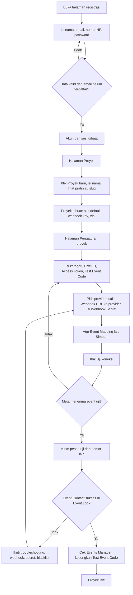

#### UF-02 — Pemrosesan pesan WhatsApp menjadi event Meta (alur sistem)

1. Customer mengklik iklan CTWA atau tombol WhatsApp di landing page, lalu mengirim pesan.
2. Provider mengirim `POST /api/v1/webhooks/wa/{webhook_key}`.
3. API mencari proyek berdasarkan `webhook_key`; jika tidak ada, jawab 404.
4. API memverifikasi signature; jika salah, jawab 401.
5. Jika proyek nonaktif atau terkunci, jawab 200 tanpa diproses.
6. Jika `provider_message_id` sudah pernah diproses, jawab 200 dan abaikan.
7. API menormalisasi payload: nomor lawan bicara, nama, arah pesan, teks, dan data atribusi.
8. Jika nomor ada di blacklist, berhenti.
9. Jika kontak belum ada: pesan dari customer membuat kontak baru dengan atribusi (`ctwa_clid`, kode referensi landing page, atau organik); pesan dari CS dihentikan.
10. API menyimpan `message_logs` dan memperbarui hitungan pesan kontak.
11. API mengevaluasi setiap slot sesuai urutan: aktif, pengirim cocok, chat minimum terpenuhi, keyword cocok atau skor mencapai threshold, dan belum pernah terkirim (dedupe). Slot yang lolos membuat event `pending` beserta nilainya.
12. API menjawab 200.
13. Worker mengambil event `pending` dan mengirimnya ke Meta CAPI: sukses menjadi `success`; error sementara dijadwalkan ulang; error permanen atau retry habis menjadi `failed`.

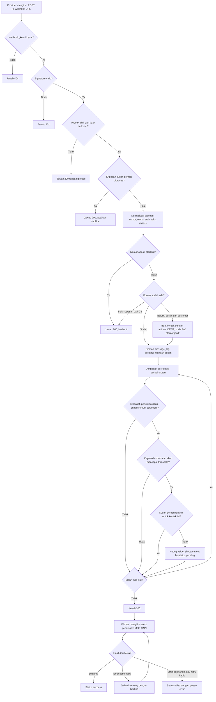

#### UF-03 — Memantau hasil dan menindaklanjuti

1. User masuk, memilih proyek di sidebar, dan membuka Dashboard.
2. User memilih periode dan membaca KPI, revenue, serta funnel.
3. Jika angka terlihat janggal, user membuka Event Log dan memfilter jenis event.
4. Jika ada nomor internal atau spam, user memasukkannya ke blacklist dari baris log.
5. Jika ada event gagal, user membaca pesan error, memperbaiki pengaturan (misalnya token kedaluwarsa), lalu klik "Kirim ulang".
6. Bila perlu, user mengekspor Event Log ke CSV (Fase 2).

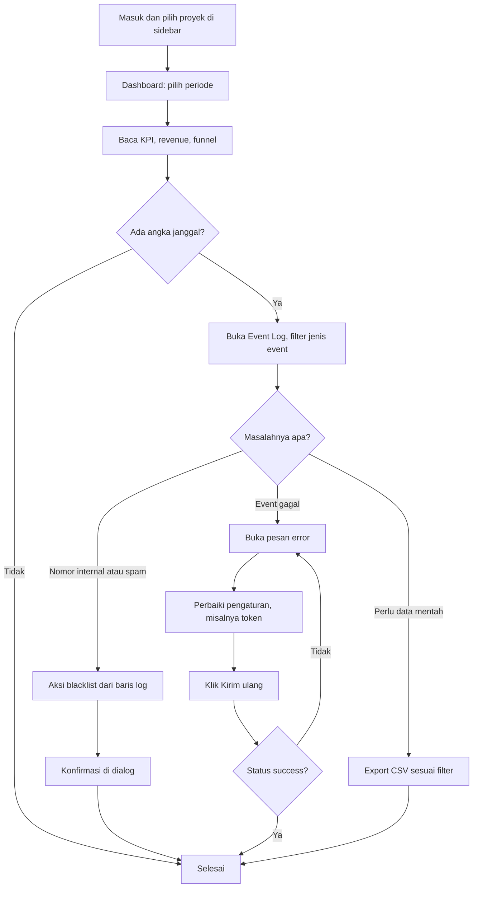

### 4.2 Alur Pendukung

#### UF-04 — Mengatur Event Mapping dan Scoring

1. User membuka Pengaturan → kartu Event Mapping.
2. User klik "Tambah slot" dan memilih event Meta; jika Custom Event, user mengisi nama event.
3. User mengisi keyword trigger (opsional) dan memilih pengirim.
4. Jika event bernilai, user memilih cara mengambil nilai; untuk nilai tetap, user mengisi nominal.
5. (Fase 2) User mengisi chat minimum dan, bila perlu, mengaktifkan scoring: pilih Auto atau Manual, isi threshold, lalu (Manual) tambah baris keyword + skor.
6. User mengatur urutan slot, lalu klik Simpan.
7. Server memvalidasi seluruh slot. Jika ada error, tidak ada yang tersimpan dan error ditandai di slot terkait; jika valid, muncul notifikasi sukses.

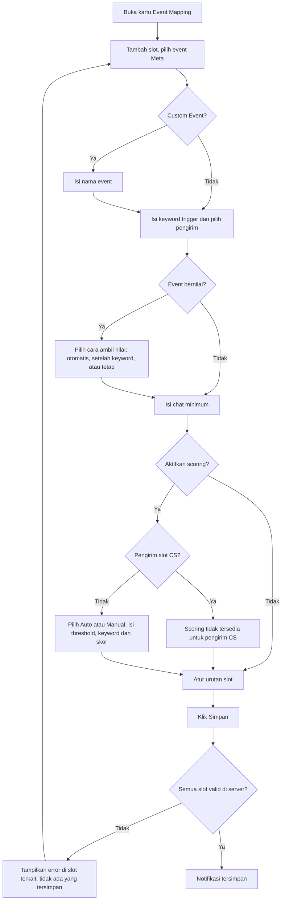

#### UF-05 — Memasang tracker landing page

1. User membuka Pengaturan → kartu Tracker Landing Page dan menyalin snippet.
2. User menempel snippet sebelum tag penutup `body` di landing page.
3. User membuka landing page di jendela privat dengan URL yang berisi parameter `fbclid` uji.
4. User klik tombol WhatsApp dan memastikan teks pesan diakhiri baris `Ref: XXXXXX`.
5. User mengirim pesan; Event Log menampilkan kontak yang terhubung dengan sesi landing page.

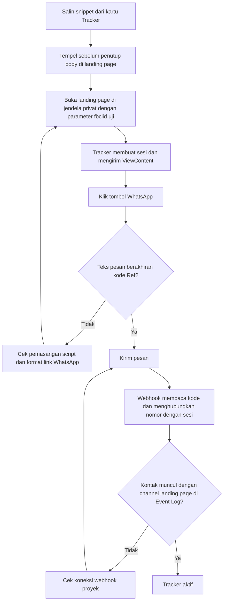

#### UF-06 — Upgrade langganan dan verifikasi admin

1. User klik Upgrade di banner atau sidebar dan masuk ke `/projects/{slug}/billing`.
2. User memilih durasi; total transfer ikut berubah.
3. User mentransfer manual ke rekening yang ditampilkan.
4. User mengunggah bukti (opsional) dan klik "Kirim pengajuan", dan/atau klik "Konfirmasi via WhatsApp".
5. Pengajuan berstatus `pending`.
6. Admin membuka `/admin/payments`, memeriksa bukti dan mutasi rekening, lalu memverifikasi atau menolak.
7. Jika diverifikasi, proyek menjadi `active` dan masa aktif diperpanjang; jika ditolak, user melihat catatan admin dan bisa mengajukan ulang.

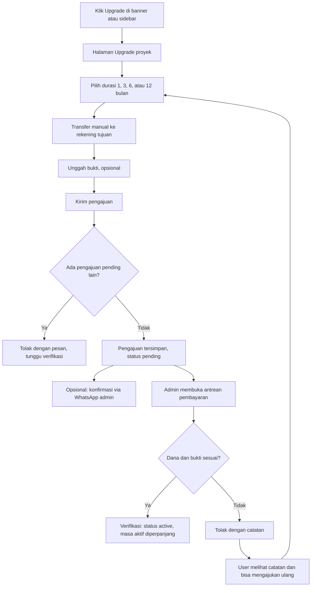

#### UF-07 — Menghubungkan Meta Ads

1. User membuka Data Iklan dan klik "Hubungkan Meta Ads".
2. Sistem membuat URL OAuth dengan `state` bertanda tangan, lalu mengarahkan ke Facebook.
3. User memberi izin; Facebook mengarahkan kembali ke callback.
4. API memvalidasi `state`, menukar `code` menjadi token, dan menyimpannya terenkripsi.
5. User memilih satu ad account.
6. Sistem menjalankan sinkron awal; data tampil di Data Iklan, Laporan Bulanan, dan Laporan Iklan.
7. Jika token kedaluwarsa, status menjadi `expired` dan user diminta menghubungkan ulang.

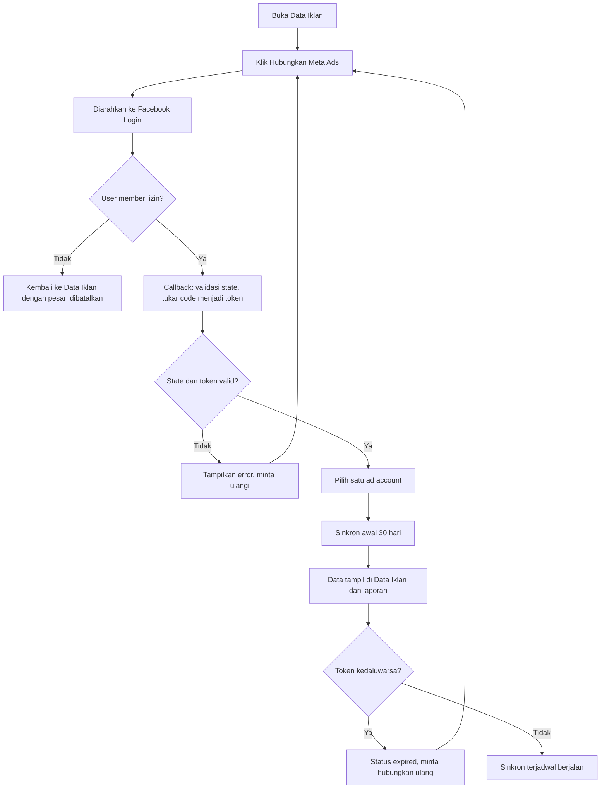

#### UF-08 — Menonaktifkan atau menghapus proyek

1. User membuka Kelola Proyek.
2. Untuk menonaktifkan: klik Nonaktifkan → konfirmasi → status berubah; webhook berhenti diproses. Aktifkan kembali dengan cara yang sama.
3. Untuk menghapus: klik Hapus → dialog meminta user mengetik nama proyek → klik Hapus permanen → semua data proyek dihapus dan user kembali ke Kelola Proyek.

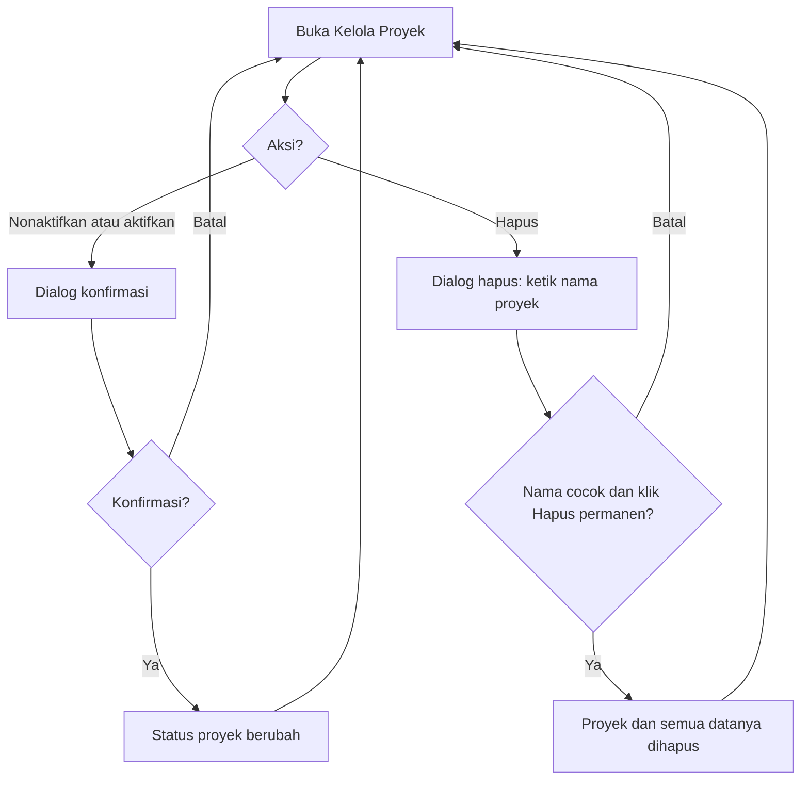

#### UF-09 — Lupa password dan ganti password

1. Lupa password: user membuka `/forgot-password`, mengisi email, dan selalu melihat pesan sukses yang sama.
2. Jika email terdaftar, sistem mengirim tautan reset yang berlaku 60 menit.
3. User membuka tautan, mengisi password baru, dan diarahkan ke login.
4. Ganti password: user membuka `/account`, mengisi password lama dan password baru, lalu klik Simpan. Jika password lama salah, error ditampilkan; jika benar, sesi lain dicabut.

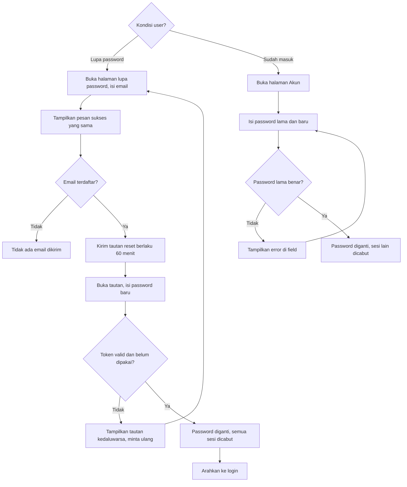

#### UF-10 — Mengubah label kartu KPI (Fase 2)

1. Di Dashboard, user klik ikon pensil pada kartu KPI.
2. Dialog terbuka berisi label saat ini.
3. User mengisi label baru (1–24 karakter) dan klik Simpan.
4. Jika valid, label langsung berubah; jika tidak, error tampil di field.

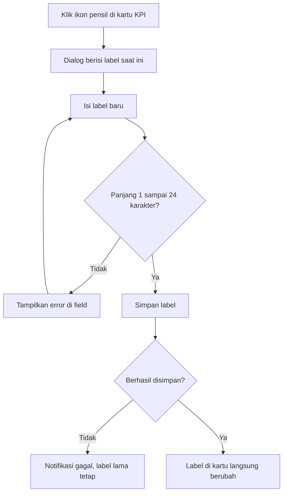

---

## 5. Architecture

### 5.1 Penjelasan singkat

- **Frontend (Next.js + TypeScript, Tailwind, shadcn/ui).** App Router; layout, navigasi, dan halaman dirender di server, sedangkan data dashboard/tabel diambil di client dengan TanStack Query [asumsi]. Request dari browser ke `/api/v1/*` diteruskan ke API Go lewat `rewrites` Next.js, sehingga cookie sesi berada di domain yang sama dan tidak perlu CORS untuk aplikasi utama. Form memakai react-hook-form + zod; grafik memakai komponen chart shadcn/ui (Recharts).
- **Backend API (Go + Gin).** REST stateless dengan susunan handler → service → repository (pgx; query bisa di-generate dengan sqlc [asumsi]). Endpoint publik (webhook WhatsApp, script tracker, sesi tracker) diakses langsung di domain API tanpa lewat Next.js.
- **Worker (Go, satu codebase dengan API).** Proses terpisah untuk (1) dispatcher event: mengambil event `pending` memakai `SELECT ... FOR UPDATE SKIP LOCKED` lalu mengirim ke Meta CAPI dengan retry/backoff; (2) scheduler: kedaluwarsa trial/langganan, sinkron insight Meta Ads, pembersihan `message_logs` sesuai retensi, dan agregasi saran keyword. Antrean memakai PostgreSQL agar tidak perlu broker tambahan di awal [asumsi].
- **Database (PostgreSQL).** Satu instance primer; read replica bisa ditambahkan untuk laporan bila beban naik. Migrasi berversi.
- **Object storage.** Storage S3-compatible (atau volume privat) untuk bukti transfer [asumsi].
- **Layanan eksternal.** Meta Conversions API (kirim event), Facebook Login + Meta Marketing API (baca insight), provider WhatsApp Business API (mengirim webhook), gateway WA QR (Fase 5), layanan email SMTP (reset password), dan tautan `wa.me` ke admin (konfirmasi pembayaran).

### 5.2 Diagram komponen

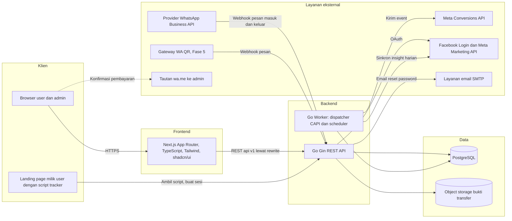

### 5.3 Urutan pemrosesan webhook

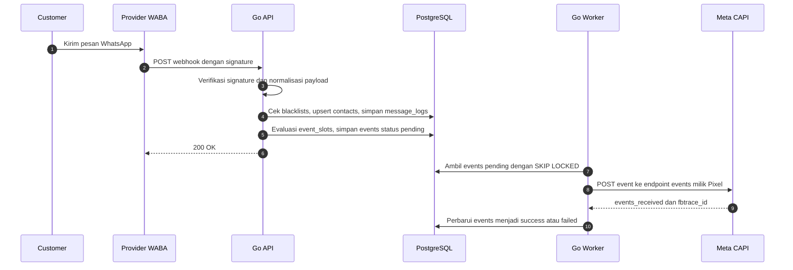

### 5.4 Modul backend

| Modul | Tanggung jawab | Tabel utama |
|---|---|---|
| auth | Registrasi, login, refresh, logout, reset password | `users`, `user_sessions`, `password_reset_tokens` |
| projects | CRUD proyek, status, kepemilikan | `projects` |
| settings | Konfigurasi Meta CAPI & WhatsApp, enkripsi rahasia, uji koneksi | `projects` |
| mapping | Slot event, keyword scoring, label KPI, keyword default | `event_slots`, `scoring_keywords`, `event_labels`, `default_keywords` |
| ingest | Webhook, normalisasi per provider (adapter), blacklist, kontak, evaluasi slot | `contacts`, `message_logs`, `contact_slot_scores`, `events` |
| dispatch (worker) | Kirim event ke Meta CAPI, retry | `events` |
| tracker | Script tracker, sesi landing page | `lp_sessions`, `events` |
| analytics | Dashboard, Event Log, laporan, export CSV | `events`, `contacts`, `message_logs`, `ad_insights_daily` |
| blacklist | CRUD blacklist | `blacklists` |
| billing | Plan, langganan, pengajuan pembayaran, upload bukti | `plans`, `payment_requests`, `payment_destinations` |
| admin | Verifikasi pembayaran, harga, rekening, pengumuman | `payment_requests`, `plans`, `payment_destinations`, `announcements` |
| metaads | OAuth, ad account, sinkron insight | `meta_ad_connections`, `ad_insights_daily` |
| learning (Fase 5) | Saran keyword | `learned_keywords`, `keyword_mentions` |
| waqr (Fase 5) | Sesi gateway QR | `wa_qr_sessions` |

### 5.5 Struktur repositori (usulan)

```text
/apps/web                  # Next.js
  /app/(auth)/...          # login, register, lupa/reset password
  /app/(app)/projects/...  # halaman proyek
  /app/(app)/admin/...     # panel admin
  /components/ui           # komponen shadcn/ui
  /components/app          # komponen aplikasi (KpiCard, PeriodFilter, ...)
  /lib/api                 # klien API + tipe hasil generate OpenAPI
/services/api              # Go
  /cmd/api                 # entrypoint REST API
  /cmd/worker              # entrypoint worker
  /internal/<modul>        # handler, service, repository per modul
  /internal/ingest/adapters# adapter payload per provider WhatsApp
  /migrations              # migrasi SQL berversi
  /openapi.yaml            # kontrak API bagian 7
```

---

## 6. Database Schema

### 6.1 Konvensi

- Nama tabel jamak, `snake_case`; nama kolom `snake_case`.
- Primary key `UUID` dengan default `gen_random_uuid()`; tabel bervolume tinggi (`events`, `message_logs`, `lp_sessions`, `ad_insights_daily`) memakai `BIGINT GENERATED ALWAYS AS IDENTITY`.
- Semua waktu `TIMESTAMPTZ` disimpan dalam UTC; agregasi memakai `AT TIME ZONE 'Asia/Jakarta'`.
- Uang memakai `NUMERIC(14,2)` dalam IDR.
- Nomor HP disimpan tanpa tanda `+`, format `62xxxxxxxxxx`.
- Kolom berakhiran `_enc` berisi data terenkripsi AES-256-GCM.
- Extension: `citext` (email tidak case-sensitive). `gen_random_uuid()` tersedia bawaan PostgreSQL 13+.

### 6.2 Tipe enum

```sql
CREATE TYPE user_role              AS ENUM ('user', 'admin');
CREATE TYPE business_category      AS ENUM ('general', 'health', 'ecommerce', 'education', 'property', 'fnb', 'service', 'travel', 'finance');
CREATE TYPE wa_connection_type     AS ENUM ('waba', 'qr');
CREATE TYPE subscription_status    AS ENUM ('trial', 'active', 'expired');
CREATE TYPE slot_sender            AS ENUM ('customer', 'cs', 'both');
CREATE TYPE value_mode             AS ENUM ('none', 'auto', 'keyword', 'fixed');
CREATE TYPE score_mode             AS ENUM ('auto', 'manual');
CREATE TYPE contact_source         AS ENUM ('ads', 'organic');
CREATE TYPE entry_channel          AS ENUM ('ctwa', 'landing_page', 'direct');
CREATE TYPE lead_quality           AS ENUM ('hot', 'warm', 'cold');
CREATE TYPE message_direction      AS ENUM ('inbound', 'outbound');   -- inbound = customer, outbound = CS
CREATE TYPE event_trigger_type     AS ENUM ('first_message', 'keyword', 'score', 'lp_visit');
CREATE TYPE event_status           AS ENUM ('pending', 'success', 'failed');
CREATE TYPE meta_connection_status AS ENUM ('connected', 'expired', 'revoked');
CREATE TYPE payment_status         AS ENUM ('pending', 'verified', 'rejected');
CREATE TYPE announcement_type      AS ENUM ('info', 'warning', 'success');
CREATE TYPE learned_keyword_status AS ENUM ('suggested', 'applied', 'dismissed');
CREATE TYPE qr_session_status      AS ENUM ('disconnected', 'pending_scan', 'connected');
```

Nilai yang diizinkan untuk kolom event Meta (`event_slots.meta_event`, dicek dengan `CHECK`): `Contact`, `Lead`, `InitiateCheckout`, `Purchase`, `CompleteRegistration`, `AddToCart`, `AddToWishlist`, `AddPaymentInfo`, `Search`, `ViewContent`, `Subscribe`, `StartTrial`, `SubmitApplication`, `Schedule`, `FindLocation`, `CustomizeProduct`, `CustomEvent`.

### 6.3 Tabel

Keterangan kolom: **Null** = boleh NULL atau tidak.

#### `users`

| Kolom | Tipe | Key | Null | Default | Unique / Index | Keterangan |
|---|---|---|---|---|---|---|
| id | UUID | PK | Tidak | gen_random_uuid() | PK | |
| name | VARCHAR(100) | | Tidak | | | Nama lengkap |
| email | CITEXT | | Tidak | | UNIQUE | Email login |
| phone | VARCHAR(20) | | Tidak | | | Format 62xxx, diisi saat registrasi [asumsi] |
| password_hash | TEXT | | Tidak | | | argon2id |
| role | user_role | | Tidak | 'user' | | |
| last_login_at | TIMESTAMPTZ | | Ya | | | |
| created_at | TIMESTAMPTZ | | Tidak | now() | | |
| updated_at | TIMESTAMPTZ | | Tidak | now() | | |

#### `user_sessions`

| Kolom | Tipe | Key | Null | Default | Unique / Index | Keterangan |
|---|---|---|---|---|---|---|
| id | UUID | PK | Tidak | gen_random_uuid() | PK | |
| user_id | UUID | FK → users.id (ON DELETE CASCADE) | Tidak | | INDEX | |
| refresh_token_hash | CHAR(64) | | Tidak | | UNIQUE | SHA-256 dari refresh token |
| user_agent | TEXT | | Ya | | | |
| ip_address | INET | | Ya | | | |
| expires_at | TIMESTAMPTZ | | Tidak | | | |
| revoked_at | TIMESTAMPTZ | | Ya | | | Diisi saat logout, rotasi, atau ganti password |
| created_at | TIMESTAMPTZ | | Tidak | now() | | |

#### `password_reset_tokens`

| Kolom | Tipe | Key | Null | Default | Unique / Index | Keterangan |
|---|---|---|---|---|---|---|
| id | UUID | PK | Tidak | gen_random_uuid() | PK | |
| user_id | UUID | FK → users.id (ON DELETE CASCADE) | Tidak | | INDEX | |
| token_hash | CHAR(64) | | Tidak | | UNIQUE | SHA-256 dari token di tautan |
| expires_at | TIMESTAMPTZ | | Tidak | | | created_at + 60 menit |
| used_at | TIMESTAMPTZ | | Ya | | | Sekali pakai |
| created_at | TIMESTAMPTZ | | Tidak | now() | | |

#### `projects`

| Kolom | Tipe | Key | Null | Default | Unique / Index | Keterangan |
|---|---|---|---|---|---|---|
| id | UUID | PK | Tidak | gen_random_uuid() | PK | |
| user_id | UUID | FK → users.id (ON DELETE CASCADE) | Tidak | | INDEX | Pemilik |
| name | VARCHAR(100) | | Tidak | | | |
| slug | VARCHAR(120) | | Tidak | | UNIQUE | Tetap setelah dibuat |
| business_category | business_category | | Tidak | 'general' | | |
| is_active | BOOLEAN | | Tidak | true | | |
| wa_connection_type | wa_connection_type | | Tidak | 'waba' | | |
| wa_provider | VARCHAR(30) | | Tidak | 'generic' | | Kode adapter provider; nilai selain `generic` diputuskan kemudian |
| webhook_key | VARCHAR(64) | | Tidak | | UNIQUE | Token acak di Webhook URL |
| webhook_secret_enc | BYTEA | | Ya | | | Secret verifikasi signature |
| pixel_id | VARCHAR(20) | | Ya | | | Hanya angka |
| capi_access_token_enc | BYTEA | | Ya | | | |
| test_event_code | VARCHAR(50) | | Ya | | | |
| currency | CHAR(3) | | Tidak | 'IDR' | | |
| timezone | VARCHAR(50) | | Tidak | 'Asia/Jakarta' | | |
| subscription_status | subscription_status | | Tidak | 'trial' | INDEX (subscription_status, trial_ends_at) | |
| trial_ends_at | TIMESTAMPTZ | | Tidak | now() + interval '7 days' | | |
| subscription_ends_at | TIMESTAMPTZ | | Ya | | INDEX | |
| keyword_learning_started_at | TIMESTAMPTZ | | Ya | | | Fase 5 |
| created_at | TIMESTAMPTZ | | Tidak | now() | | |
| updated_at | TIMESTAMPTZ | | Tidak | now() | | |

#### `event_slots`

| Kolom | Tipe | Key | Null | Default | Unique / Index | Keterangan |
|---|---|---|---|---|---|---|
| id | UUID | PK | Tidak | gen_random_uuid() | PK | |
| project_id | UUID | FK → projects.id (ON DELETE CASCADE) | Tidak | | UNIQUE (project_id, position) | |
| position | SMALLINT | | Tidak | | lihat atas | Urutan funnel, mulai 1 |
| is_active | BOOLEAN | | Tidak | true | | |
| meta_event | VARCHAR(50) | | Tidak | | | CHECK daftar event Meta |
| custom_event_name | VARCHAR(50) | | Ya | | | Wajib bila meta_event = 'CustomEvent' (CHECK) |
| trigger_keywords | TEXT[] | | Tidak | '{}' | | Kosong = semua pesan |
| sender | slot_sender | | Tidak | 'both' | | |
| value_mode | value_mode | | Tidak | 'none' | | Selain 'none' hanya untuk event bernilai (validasi service) |
| fixed_value | NUMERIC(14,2) | | Ya | | | Wajib > 0 bila value_mode = 'fixed' (CHECK) |
| min_chat | SMALLINT | | Tidak | 0 | | CHECK ≥ 0, Fase 2 |
| scoring_enabled | BOOLEAN | | Tidak | false | | CHECK tidak boleh true bila sender = 'cs' |
| score_mode | score_mode | | Ya | | | Wajib bila scoring_enabled |
| score_threshold | INTEGER | | Ya | | | CHECK 1–9999, wajib bila scoring_enabled |
| created_at | TIMESTAMPTZ | | Tidak | now() | | |
| updated_at | TIMESTAMPTZ | | Tidak | now() | | |

#### `scoring_keywords`

| Kolom | Tipe | Key | Null | Default | Unique / Index | Keterangan |
|---|---|---|---|---|---|---|
| id | UUID | PK | Tidak | gen_random_uuid() | PK | |
| slot_id | UUID | FK → event_slots.id (ON DELETE CASCADE) | Tidak | | UNIQUE (slot_id, lower(keyword)) | |
| keyword | VARCHAR(100) | | Tidak | | lihat atas | |
| score | INTEGER | | Tidak | 10 | | CHECK 1–9999 |
| created_at | TIMESTAMPTZ | | Tidak | now() | | |

#### `default_keywords`

| Kolom | Tipe | Key | Null | Default | Unique / Index | Keterangan |
|---|---|---|---|---|---|---|
| id | INTEGER | PK (identity) | Tidak | identity | PK | |
| business_category | business_category | | Tidak | | UNIQUE (business_category, keyword) | |
| keyword | VARCHAR(100) | | Tidak | | lihat atas | |
| score | INTEGER | | Tidak | 10 | | |
| created_at | TIMESTAMPTZ | | Tidak | now() | | Isi awal disiapkan tim [asumsi] |

#### `event_labels`

| Kolom | Tipe | Key | Null | Default | Unique / Index | Keterangan |
|---|---|---|---|---|---|---|
| project_id | UUID | PK, FK → projects.id (ON DELETE CASCADE) | Tidak | | PK (project_id, event_name) | |
| event_name | VARCHAR(50) | PK | Tidak | | lihat atas | CHECK salah satu: Contact, Lead, InitiateCheckout, Purchase |
| label | VARCHAR(24) | | Tidak | | | CHECK panjang ≥ 1 |
| updated_at | TIMESTAMPTZ | | Tidak | now() | | |

#### `contacts`

| Kolom | Tipe | Key | Null | Default | Unique / Index | Keterangan |
|---|---|---|---|---|---|---|
| id | UUID | PK | Tidak | gen_random_uuid() | PK | |
| project_id | UUID | FK → projects.id (ON DELETE CASCADE) | Tidak | | UNIQUE (project_id, phone); INDEX (project_id, first_seen_at); INDEX (project_id, ad_id) | |
| phone | VARCHAR(20) | | Tidak | | lihat atas | 62xxx |
| name | VARCHAR(150) | | Ya | | | Nama profil WhatsApp |
| source | contact_source | | Tidak | 'organic' | | |
| entry_channel | entry_channel | | Tidak | 'direct' | | CTWA, landing page, atau langsung [asumsi] |
| platform | VARCHAR(20) | | Ya | | | facebook atau instagram |
| ctwa_clid | VARCHAR(500) | | Ya | | | |
| ad_id | VARCHAR(50) | | Ya | | | |
| ad_name | VARCHAR(255) | | Ya | | | |
| lead_score | INTEGER | | Tidak | 0 | | Total skor semua slot scoring |
| lead_quality | lead_quality | | Ya | | | Diperbarui pipeline [asumsi: rasio skor/threshold tertinggi] |
| inbound_count | INTEGER | | Tidak | 0 | | Jumlah pesan dari customer |
| outbound_count | INTEGER | | Tidak | 0 | | Jumlah pesan dari CS |
| first_seen_at | TIMESTAMPTZ | | Tidak | now() | lihat atas | |
| last_message_at | TIMESTAMPTZ | | Tidak | now() | | |
| created_at | TIMESTAMPTZ | | Tidak | now() | | |
| updated_at | TIMESTAMPTZ | | Tidak | now() | | |

#### `contact_slot_scores`

Tabel penghubung N-N antara `contacts` dan `event_slots` untuk skor per slot.

| Kolom | Tipe | Key | Null | Default | Unique / Index | Keterangan |
|---|---|---|---|---|---|---|
| contact_id | UUID | PK, FK → contacts.id (ON DELETE CASCADE) | Tidak | | PK (contact_id, slot_id) | |
| slot_id | UUID | PK, FK → event_slots.id (ON DELETE CASCADE) | Tidak | | INDEX (slot_id) | |
| score | INTEGER | | Tidak | 0 | | Akumulatif |
| threshold_reached_at | TIMESTAMPTZ | | Ya | | | Diisi saat event dikirim |
| updated_at | TIMESTAMPTZ | | Tidak | now() | | |

#### `message_logs`

Metadata pesan tanpa isi pesan.

| Kolom | Tipe | Key | Null | Default | Unique / Index | Keterangan |
|---|---|---|---|---|---|---|
| id | BIGINT | PK (identity) | Tidak | identity | PK | |
| project_id | UUID | FK → projects.id (ON DELETE CASCADE) | Tidak | | INDEX (project_id, sent_at); UNIQUE (project_id, provider_message_id) WHERE provider_message_id IS NOT NULL | |
| contact_id | UUID | FK → contacts.id (ON DELETE CASCADE) | Tidak | | INDEX (contact_id, sent_at) | |
| direction | message_direction | | Tidak | | | |
| provider_message_id | VARCHAR(150) | | Ya | | lihat atas | Untuk menolak webhook ganda |
| sent_at | TIMESTAMPTZ | | Tidak | | lihat atas | Waktu pesan menurut provider |
| created_at | TIMESTAMPTZ | | Tidak | now() | | Retensi 180 hari [asumsi] |

#### `lp_sessions`

| Kolom | Tipe | Key | Null | Default | Unique / Index | Keterangan |
|---|---|---|---|---|---|---|
| id | BIGINT | PK (identity) | Tidak | identity | PK | |
| project_id | UUID | FK → projects.id (ON DELETE CASCADE) | Tidak | | INDEX (project_id, created_at) | |
| ref_code | VARCHAR(12) | | Tidak | | UNIQUE | Kode referensi di pesan WhatsApp |
| landing_url | TEXT | | Tidak | | | |
| referrer | TEXT | | Ya | | | |
| fbclid | VARCHAR(500) | | Ya | | | |
| fbc | VARCHAR(600) | | Ya | | | Format fb.1.{timestamp}.{fbclid} |
| fbp | VARCHAR(100) | | Ya | | | Cookie browser Meta bila ada [asumsi] |
| utm_source | VARCHAR(255) | | Ya | | | |
| utm_medium | VARCHAR(255) | | Ya | | | |
| utm_campaign | VARCHAR(255) | | Ya | | | |
| utm_content | VARCHAR(255) | | Ya | | | |
| ad_id | VARCHAR(50) | | Ya | | | Dari parameter URL [asumsi] |
| client_ip | INET | | Ya | | | |
| user_agent | TEXT | | Ya | | | |
| contact_id | UUID | FK → contacts.id (ON DELETE SET NULL) | Ya | | INDEX | Terisi setelah pesan berkode masuk |
| linked_at | TIMESTAMPTZ | | Ya | | | |
| created_at | TIMESTAMPTZ | | Tidak | now() | lihat atas | |

#### `events`

| Kolom | Tipe | Key | Null | Default | Unique / Index | Keterangan |
|---|---|---|---|---|---|---|
| id | BIGINT | PK (identity) | Tidak | identity | PK | |
| project_id | UUID | FK → projects.id (ON DELETE CASCADE) | Tidak | | INDEX (project_id, occurred_at DESC); INDEX (project_id, event_name, occurred_at); INDEX (project_id, ad_id, occurred_at) | |
| contact_id | UUID | FK → contacts.id (ON DELETE SET NULL) | Ya | | INDEX | NULL untuk ViewContent landing page |
| lp_session_id | BIGINT | FK → lp_sessions.id (ON DELETE SET NULL) | Ya | | | |
| slot_id | UUID | FK → event_slots.id (ON DELETE SET NULL) | Ya | | | |
| event_name | VARCHAR(50) | | Tidak | | lihat atas | Nama yang dikirim ke Meta (standar atau custom) |
| trigger_type | event_trigger_type | | Tidak | | | |
| trigger_detail | VARCHAR(150) | | Ya | | | Keyword yang cocok atau skor saat mencapai threshold |
| value | NUMERIC(14,2) | | Ya | | | |
| currency | CHAR(3) | | Tidak | 'IDR' | | |
| source | contact_source | | Tidak | 'organic' | | Salinan dari kontak saat event dibuat |
| entry_channel | entry_channel | | Tidak | 'direct' | | Salinan dari kontak/sesi |
| platform | VARCHAR(20) | | Ya | | | |
| ad_id | VARCHAR(50) | | Ya | | lihat atas | |
| ad_name | VARCHAR(255) | | Ya | | | |
| meta_event_id | UUID | | Tidak | gen_random_uuid() | UNIQUE | Dikirim sebagai `event_id` ke Meta |
| dedupe_key | VARCHAR(150) | | Ya | | UNIQUE (project_id, dedupe_key) WHERE dedupe_key IS NOT NULL | Contoh `Lead:{contact_id}` atau `Purchase:{provider_message_id}` |
| is_test | BOOLEAN | | Tidak | false | | true bila dikirim dengan Test Event Code |
| status | event_status | | Tidak | 'pending' | INDEX (next_attempt_at) WHERE status = 'pending' | |
| attempt_count | SMALLINT | | Tidak | 0 | | |
| next_attempt_at | TIMESTAMPTZ | | Ya | now() | lihat atas | |
| error_message | TEXT | | Ya | | | |
| meta_response | JSONB | | Ya | | | events_received, fbtrace_id, error |
| occurred_at | TIMESTAMPTZ | | Tidak | | lihat atas | Waktu pesan pemicu |
| sent_at | TIMESTAMPTZ | | Ya | | | |
| created_at | TIMESTAMPTZ | | Tidak | now() | | |

#### `blacklists`

| Kolom | Tipe | Key | Null | Default | Unique / Index | Keterangan |
|---|---|---|---|---|---|---|
| id | UUID | PK | Tidak | gen_random_uuid() | PK | |
| project_id | UUID | FK → projects.id (ON DELETE CASCADE) | Tidak | | UNIQUE (project_id, phone) | |
| phone | VARCHAR(20) | | Tidak | | lihat atas | 62xxx |
| reason | VARCHAR(255) | | Ya | | | |
| created_by | UUID | FK → users.id (ON DELETE SET NULL) | Ya | | | |
| created_at | TIMESTAMPTZ | | Tidak | now() | | |

#### `meta_ad_connections`

| Kolom | Tipe | Key | Null | Default | Unique / Index | Keterangan |
|---|---|---|---|---|---|---|
| id | UUID | PK | Tidak | gen_random_uuid() | PK | |
| project_id | UUID | FK → projects.id (ON DELETE CASCADE) | Tidak | | UNIQUE | Relasi 1-1 |
| fb_user_id | VARCHAR(50) | | Tidak | | | |
| access_token_enc | BYTEA | | Tidak | | | Token jangka panjang |
| token_expires_at | TIMESTAMPTZ | | Ya | | | |
| ad_account_id | VARCHAR(50) | | Ya | | | Diisi setelah user memilih |
| ad_account_name | VARCHAR(255) | | Ya | | | |
| status | meta_connection_status | | Tidak | 'connected' | | |
| last_synced_at | TIMESTAMPTZ | | Ya | | | |
| created_at | TIMESTAMPTZ | | Tidak | now() | | |
| updated_at | TIMESTAMPTZ | | Tidak | now() | | |

#### `ad_insights_daily`

| Kolom | Tipe | Key | Null | Default | Unique / Index | Keterangan |
|---|---|---|---|---|---|---|
| id | BIGINT | PK (identity) | Tidak | identity | PK | |
| project_id | UUID | FK → projects.id (ON DELETE CASCADE) | Tidak | | UNIQUE (project_id, insight_date, ad_id); INDEX (project_id, insight_date) | |
| insight_date | DATE | | Tidak | | lihat atas | Tanggal menurut zona waktu ad account |
| campaign_id | VARCHAR(50) | | Tidak | | | |
| campaign_name | VARCHAR(255) | | Tidak | | | |
| adset_id | VARCHAR(50) | | Tidak | | | |
| adset_name | VARCHAR(255) | | Tidak | | | |
| ad_id | VARCHAR(50) | | Tidak | | lihat atas | Dicocokkan dengan events.ad_id |
| ad_name | VARCHAR(255) | | Tidak | | | |
| spend | NUMERIC(14,2) | | Tidak | 0 | | |
| impressions | INTEGER | | Tidak | 0 | | [asumsi] |
| clicks | INTEGER | | Tidak | 0 | | |
| synced_at | TIMESTAMPTZ | | Tidak | now() | | |

#### `plans`

| Kolom | Tipe | Key | Null | Default | Unique / Index | Keterangan |
|---|---|---|---|---|---|---|
| id | SMALLINT | PK (identity) | Tidak | identity | PK | |
| duration_months | SMALLINT | | Tidak | | UNIQUE | CHECK salah satu: 1, 3, 6, 12 |
| price | NUMERIC(12,2) | | Tidak | | | Total harga untuk durasi tersebut, CHECK > 0 |
| is_active | BOOLEAN | | Tidak | true | | |
| created_at | TIMESTAMPTZ | | Tidak | now() | | |
| updated_at | TIMESTAMPTZ | | Tidak | now() | | |

#### `payment_requests`

| Kolom | Tipe | Key | Null | Default | Unique / Index | Keterangan |
|---|---|---|---|---|---|---|
| id | UUID | PK | Tidak | gen_random_uuid() | PK | |
| user_id | UUID | FK → users.id (ON DELETE RESTRICT) | Tidak | | INDEX | Pemohon |
| project_id | UUID | FK → projects.id (ON DELETE SET NULL) | Ya | | INDEX; UNIQUE (project_id) WHERE status = 'pending' | Catatan keuangan tetap ada bila proyek dihapus [asumsi] |
| project_name | VARCHAR(100) | | Tidak | | | Salinan nama saat pengajuan |
| plan_id | SMALLINT | FK → plans.id (ON DELETE RESTRICT) | Tidak | | | |
| months | SMALLINT | | Tidak | | | Salinan dari plan |
| amount | NUMERIC(12,2) | | Tidak | | | Salinan harga saat pengajuan |
| proof_file_key | TEXT | | Ya | | | Kunci objek di storage |
| proof_file_mime | VARCHAR(50) | | Ya | | | image/jpeg, image/png, application/pdf |
| status | payment_status | | Tidak | 'pending' | INDEX (status, created_at) | |
| admin_note | TEXT | | Ya | | | Wajib bila rejected |
| verified_by | UUID | FK → users.id (ON DELETE SET NULL) | Ya | | | Admin |
| verified_at | TIMESTAMPTZ | | Ya | | | Waktu verifikasi atau penolakan |
| created_at | TIMESTAMPTZ | | Tidak | now() | lihat atas | |
| updated_at | TIMESTAMPTZ | | Tidak | now() | | |

#### `payment_destinations`

| Kolom | Tipe | Key | Null | Default | Unique / Index | Keterangan |
|---|---|---|---|---|---|---|
| id | SMALLINT | PK (identity) | Tidak | identity | PK | |
| bank_name | VARCHAR(50) | | Tidak | | | |
| account_number | VARCHAR(30) | | Tidak | | | |
| account_holder | VARCHAR(100) | | Tidak | | | |
| admin_whatsapp | VARCHAR(20) | | Tidak | | | 62xxx untuk tautan wa.me |
| is_active | BOOLEAN | | Tidak | true | UNIQUE (is_active) WHERE is_active | Hanya satu baris aktif |
| updated_at | TIMESTAMPTZ | | Tidak | now() | | |

#### `announcements`

| Kolom | Tipe | Key | Null | Default | Unique / Index | Keterangan |
|---|---|---|---|---|---|---|
| id | UUID | PK | Tidak | gen_random_uuid() | PK | |
| message | VARCHAR(500) | | Tidak | | | |
| type | announcement_type | | Tidak | 'info' | | |
| is_active | BOOLEAN | | Tidak | true | INDEX (is_active, starts_at) | |
| starts_at | TIMESTAMPTZ | | Tidak | now() | lihat atas | |
| ends_at | TIMESTAMPTZ | | Ya | | | NULL = tanpa batas |
| created_by | UUID | FK → users.id (ON DELETE SET NULL) | Ya | | | Admin |
| created_at | TIMESTAMPTZ | | Tidak | now() | | |
| updated_at | TIMESTAMPTZ | | Tidak | now() | | |

#### `learned_keywords` (Fase 5)

| Kolom | Tipe | Key | Null | Default | Unique / Index | Keterangan |
|---|---|---|---|---|---|---|
| id | UUID | PK | Tidak | gen_random_uuid() | PK | |
| project_id | UUID | FK → projects.id (ON DELETE CASCADE) | Tidak | | UNIQUE (project_id, phrase) | |
| phrase | VARCHAR(100) | | Tidak | | lihat atas | Huruf kecil, 1–3 kata |
| mention_count | INTEGER | | Tidak | 0 | | Jumlah kontak berbeda |
| purchase_count | INTEGER | | Tidak | 0 | | Dari kontak tersebut yang Purchase |
| status | learned_keyword_status | | Tidak | 'suggested' | | |
| applied_slot_id | UUID | FK → event_slots.id (ON DELETE SET NULL) | Ya | | | |
| updated_at | TIMESTAMPTZ | | Tidak | now() | | |

#### `keyword_mentions` (Fase 5)

Tabel penghubung N-N antara `learned_keywords` dan `contacts`.

| Kolom | Tipe | Key | Null | Default | Unique / Index | Keterangan |
|---|---|---|---|---|---|---|
| learned_keyword_id | UUID | PK, FK → learned_keywords.id (ON DELETE CASCADE) | Tidak | | PK (learned_keyword_id, contact_id) | |
| contact_id | UUID | PK, FK → contacts.id (ON DELETE CASCADE) | Tidak | | INDEX (contact_id) | |
| first_mentioned_at | TIMESTAMPTZ | | Tidak | now() | | |

#### `wa_qr_sessions` (Fase 5)

| Kolom | Tipe | Key | Null | Default | Unique / Index | Keterangan |
|---|---|---|---|---|---|---|
| id | UUID | PK | Tidak | gen_random_uuid() | PK | |
| project_id | UUID | FK → projects.id (ON DELETE CASCADE) | Tidak | | UNIQUE | Relasi 1-1 |
| gateway_session_id | VARCHAR(100) | | Ya | | | ID sesi di gateway |
| status | qr_session_status | | Tidak | 'disconnected' | | |
| connected_phone | VARCHAR(20) | | Ya | | | |
| last_connected_at | TIMESTAMPTZ | | Ya | | | |
| updated_at | TIMESTAMPTZ | | Tidak | now() | | |

### 6.4 Relasi antar tabel

| Relasi | Jenis | Melalui |
|---|---|---|
| users → projects | 1-N | projects.user_id |
| users → user_sessions | 1-N | user_sessions.user_id |
| users → password_reset_tokens | 1-N | password_reset_tokens.user_id |
| users → payment_requests (pemohon) | 1-N | payment_requests.user_id |
| users → payment_requests (admin verifikator) | 1-N (opsional) | payment_requests.verified_by |
| users → blacklists | 1-N (opsional) | blacklists.created_by |
| users → announcements | 1-N (opsional) | announcements.created_by |
| projects → event_slots | 1-N | event_slots.project_id |
| event_slots → scoring_keywords | 1-N | scoring_keywords.slot_id |
| projects → event_labels | 1-N (maksimal 4) | event_labels.project_id |
| projects → contacts | 1-N | contacts.project_id |
| contacts ↔ event_slots | N-N | contact_slot_scores |
| contacts → message_logs | 1-N | message_logs.contact_id |
| projects → message_logs | 1-N | message_logs.project_id |
| projects → lp_sessions | 1-N | lp_sessions.project_id |
| contacts → lp_sessions | 1-N (opsional) | lp_sessions.contact_id |
| projects → events | 1-N | events.project_id |
| contacts → events | 1-N (opsional) | events.contact_id |
| event_slots → events | 1-N (opsional) | events.slot_id |
| lp_sessions → events | 1-N (opsional) | events.lp_session_id |
| projects → blacklists | 1-N | blacklists.project_id |
| projects → meta_ad_connections | 1-1 (opsional) | meta_ad_connections.project_id UNIQUE |
| projects → ad_insights_daily | 1-N | ad_insights_daily.project_id |
| plans → payment_requests | 1-N | payment_requests.plan_id |
| projects → payment_requests | 1-N (opsional) | payment_requests.project_id |
| projects → learned_keywords | 1-N | learned_keywords.project_id |
| learned_keywords ↔ contacts | N-N | keyword_mentions |
| event_slots → learned_keywords | 1-N (opsional) | learned_keywords.applied_slot_id |
| projects → wa_qr_sessions | 1-1 (opsional) | wa_qr_sessions.project_id UNIQUE |
| business_category → default_keywords | relasi logis lewat nilai enum, tanpa FK | default_keywords.business_category = projects.business_category |

### 6.5 ERD

```mermaid
erDiagram
    users {
        uuid id PK
        varchar name
        citext email UK
        varchar phone
        text password_hash
        user_role role
        timestamptz last_login_at
        timestamptz created_at
        timestamptz updated_at
    }
    user_sessions {
        uuid id PK
        uuid user_id FK
        char refresh_token_hash UK
        text user_agent
        inet ip_address
        timestamptz expires_at
        timestamptz revoked_at
        timestamptz created_at
    }
    password_reset_tokens {
        uuid id PK
        uuid user_id FK
        char token_hash UK
        timestamptz expires_at
        timestamptz used_at
        timestamptz created_at
    }
    projects {
        uuid id PK
        uuid user_id FK
        varchar name
        varchar slug UK
        business_category business_category
        boolean is_active
        wa_connection_type wa_connection_type
        varchar wa_provider
        varchar webhook_key UK
        bytea webhook_secret_enc
        varchar pixel_id
        bytea capi_access_token_enc
        varchar test_event_code
        char currency
        varchar timezone
        subscription_status subscription_status
        timestamptz trial_ends_at
        timestamptz subscription_ends_at
        timestamptz keyword_learning_started_at
        timestamptz created_at
        timestamptz updated_at
    }
    event_slots {
        uuid id PK
        uuid project_id FK
        smallint position
        boolean is_active
        varchar meta_event
        varchar custom_event_name
        text_array trigger_keywords
        slot_sender sender
        value_mode value_mode
        numeric fixed_value
        smallint min_chat
        boolean scoring_enabled
        score_mode score_mode
        int score_threshold
        timestamptz created_at
        timestamptz updated_at
    }
    scoring_keywords {
        uuid id PK
        uuid slot_id FK
        varchar keyword
        int score
        timestamptz created_at
    }
    default_keywords {
        int id PK
        business_category business_category
        varchar keyword
        int score
        timestamptz created_at
    }
    event_labels {
        uuid project_id PK, FK
        varchar event_name PK
        varchar label
        timestamptz updated_at
    }
    contacts {
        uuid id PK
        uuid project_id FK
        varchar phone
        varchar name
        contact_source source
        entry_channel entry_channel
        varchar platform
        varchar ctwa_clid
        varchar ad_id
        varchar ad_name
        int lead_score
        lead_quality lead_quality
        int inbound_count
        int outbound_count
        timestamptz first_seen_at
        timestamptz last_message_at
        timestamptz created_at
        timestamptz updated_at
    }
    contact_slot_scores {
        uuid contact_id PK, FK
        uuid slot_id PK, FK
        int score
        timestamptz threshold_reached_at
        timestamptz updated_at
    }
    message_logs {
        bigint id PK
        uuid project_id FK
        uuid contact_id FK
        message_direction direction
        varchar provider_message_id
        timestamptz sent_at
        timestamptz created_at
    }
    lp_sessions {
        bigint id PK
        uuid project_id FK
        varchar ref_code UK
        text landing_url
        text referrer
        varchar fbclid
        varchar fbc
        varchar fbp
        varchar utm_source
        varchar utm_medium
        varchar utm_campaign
        varchar utm_content
        varchar ad_id
        inet client_ip
        text user_agent
        uuid contact_id FK
        timestamptz linked_at
        timestamptz created_at
    }
    events {
        bigint id PK
        uuid project_id FK
        uuid contact_id FK
        bigint lp_session_id FK
        uuid slot_id FK
        varchar event_name
        event_trigger_type trigger_type
        varchar trigger_detail
        numeric value
        char currency
        contact_source source
        entry_channel entry_channel
        varchar platform
        varchar ad_id
        varchar ad_name
        uuid meta_event_id UK
        varchar dedupe_key
        boolean is_test
        event_status status
        smallint attempt_count
        timestamptz next_attempt_at
        text error_message
        jsonb meta_response
        timestamptz occurred_at
        timestamptz sent_at
        timestamptz created_at
    }
    blacklists {
        uuid id PK
        uuid project_id FK
        varchar phone
        varchar reason
        uuid created_by FK
        timestamptz created_at
    }
    meta_ad_connections {
        uuid id PK
        uuid project_id FK, UK
        varchar fb_user_id
        bytea access_token_enc
        timestamptz token_expires_at
        varchar ad_account_id
        varchar ad_account_name
        meta_connection_status status
        timestamptz last_synced_at
        timestamptz created_at
        timestamptz updated_at
    }
    ad_insights_daily {
        bigint id PK
        uuid project_id FK
        date insight_date
        varchar campaign_id
        varchar campaign_name
        varchar adset_id
        varchar adset_name
        varchar ad_id
        varchar ad_name
        numeric spend
        int impressions
        int clicks
        timestamptz synced_at
    }
    plans {
        smallint id PK
        smallint duration_months UK
        numeric price
        boolean is_active
        timestamptz created_at
        timestamptz updated_at
    }
    payment_requests {
        uuid id PK
        uuid user_id FK
        uuid project_id FK
        varchar project_name
        smallint plan_id FK
        smallint months
        numeric amount
        text proof_file_key
        varchar proof_file_mime
        payment_status status
        text admin_note
        uuid verified_by FK
        timestamptz verified_at
        timestamptz created_at
        timestamptz updated_at
    }
    payment_destinations {
        smallint id PK
        varchar bank_name
        varchar account_number
        varchar account_holder
        varchar admin_whatsapp
        boolean is_active
        timestamptz updated_at
    }
    announcements {
        uuid id PK
        varchar message
        announcement_type type
        boolean is_active
        timestamptz starts_at
        timestamptz ends_at
        uuid created_by FK
        timestamptz created_at
        timestamptz updated_at
    }
    learned_keywords {
        uuid id PK
        uuid project_id FK
        varchar phrase
        int mention_count
        int purchase_count
        learned_keyword_status status
        uuid applied_slot_id FK
        timestamptz updated_at
    }
    keyword_mentions {
        uuid learned_keyword_id PK, FK
        uuid contact_id PK, FK
        timestamptz first_mentioned_at
    }
    wa_qr_sessions {
        uuid id PK
        uuid project_id FK, UK
        varchar gateway_session_id
        qr_session_status status
        varchar connected_phone
        timestamptz last_connected_at
        timestamptz updated_at
    }

    users ||--o{ projects : "memiliki"
    users ||--o{ user_sessions : "punya"
    users ||--o{ password_reset_tokens : "meminta"
    users ||--o{ payment_requests : "mengajukan"
    users |o--o{ payment_requests : "memverifikasi"
    users |o--o{ blacklists : "menambahkan"
    users |o--o{ announcements : "membuat"
    projects ||--o{ event_slots : "punya"
    event_slots ||--o{ scoring_keywords : "punya"
    projects ||--o{ event_labels : "punya"
    projects ||--o{ contacts : "punya"
    contacts ||--o{ contact_slot_scores : "punya skor"
    event_slots ||--o{ contact_slot_scores : "menilai"
    contacts ||--o{ message_logs : "punya"
    projects ||--o{ message_logs : "mencatat"
    projects ||--o{ lp_sessions : "mencatat"
    contacts |o--o{ lp_sessions : "terhubung"
    projects ||--o{ events : "punya"
    contacts |o--o{ events : "memicu"
    event_slots |o--o{ events : "menghasilkan"
    lp_sessions |o--o{ events : "menghasilkan"
    projects ||--o{ blacklists : "punya"
    projects ||--o| meta_ad_connections : "terhubung"
    projects ||--o{ ad_insights_daily : "punya"
    plans ||--o{ payment_requests : "dipilih"
    projects |o--o{ payment_requests : "untuk"
    projects ||--o{ learned_keywords : "punya"
    learned_keywords ||--o{ keyword_mentions : "disebut"
    contacts ||--o{ keyword_mentions : "menyebut"
    event_slots |o--o{ learned_keywords : "diterapkan ke"
    projects ||--o| wa_qr_sessions : "punya"
```

Catatan ERD: tipe `text_array` mewakili `TEXT[]`. `default_keywords` tidak punya FK; hubungannya dengan `projects` lewat nilai `business_category`.

---

## 7. API Contract

### 7.1 Konvensi umum

- **Base URL:** `https://api.example.com/api/v1`. Dari frontend dipanggil sebagai `/api/v1/...` lewat rewrite Next.js. Endpoint publik (webhook, tracker) dipanggil langsung ke domain API.
- **Format:** JSON, nama field `snake_case` (sama dengan nama kolom di bagian 6), waktu ISO 8601 UTC, tanggal `YYYY-MM-DD` (Asia/Jakarta), uang berupa angka dalam IDR.
- **Respons sukses:** `{ "data": ... }`. Daftar berpaginasi menambah `"meta": { "page", "per_page", "total", "total_pages" }`.
- **Respons error:**

```json
{
  "error": {
    "code": "VALIDATION_ERROR",
    "message": "Data tidak valid.",
    "details": [{ "field": "pixel_id", "message": "Pixel ID hanya boleh berisi angka." }]
  }
}
```

- **Autentikasi:** cookie `access_token` (JWT 15 menit) dan `refresh_token` (30 hari), keduanya httpOnly. Request mutasi (POST/PUT/PATCH/DELETE) wajib mengirim header `X-CSRF-Token` yang nilainya sama dengan cookie `csrf_token`. Bila mendapat 401, frontend memanggil `POST /auth/refresh` sekali lalu mengulang request.
- **Kolom "Auth"** di setiap endpoint: **Tidak** (publik), **User** (login, dan pemilik proyek untuk path `/projects/{slug}/...`), **Admin** (role admin), **Signature** (diverifikasi dengan webhook secret).
- **`{slug}`** adalah `projects.slug`. Proyek yang tidak ada atau bukan milik user dijawab 404.
- **Parameter periode** (dipakai Dashboard, Event Log, laporan): `period` = `today`, `yesterday`, `last_3_days`, `last_7_days`, `last_14_days`, `last_30_days`, `last_90_days`, `this_week`, `last_week`, `this_month`, `last_month`, `custom`. Untuk `custom`, `from` dan `to` (YYYY-MM-DD) wajib, maksimal 366 hari [asumsi]. Setiap halaman hanya menampilkan sebagian preset.
- **Paginasi:** `page` (default 1), `per_page` (default 50, maksimal 100).
- **Proyek terkunci (expired):** endpoint baca tetap jalan; kirim ulang event, uji koneksi CAPI, dan sinkron Meta Ads dijawab `402 SUBSCRIPTION_EXPIRED` [asumsi].
- **Status code umum:** `200` OK, `201` dibuat, `202` diterima untuk diproses, `204` tanpa isi, `400` format request salah, `401` belum login atau signature salah, `402` langganan habis, `403` bukan admin, `404` tidak ditemukan, `409` konflik/duplikat, `413` file/payload terlalu besar, `415` tipe file tidak didukung, `422` validasi gagal, `429` rate limit, `500` error server, `502` layanan eksternal gagal.

**Field turunan.** Field berikut muncul di API tetapi tidak ada sebagai kolom; semua field lain sama persis dengan nama kolom di bagian 6.

| Field API | Sumber |
|---|---|
| `webhook_url` | Base URL + `projects.webhook_key` |
| `tracker_snippet` | Dibangun dari `projects.slug` |
| `capi_access_token` (request) | Disimpan terenkripsi ke `projects.capi_access_token_enc` |
| `capi_access_token_masked`, `has_capi_access_token` | Dari `projects.capi_access_token_enc` |
| `webhook_secret` (request/respons sekali) | Disimpan terenkripsi ke `projects.webhook_secret_enc` |
| `has_webhook_secret` | Dari `projects.webhook_secret_enc` |
| `scoring_keywords` (di dalam slot) | Baris `scoring_keywords` milik slot |
| `label` default | Bila tidak ada baris di `event_labels`: Contact = "Kontak Masuk", Lead = "Lead", InitiateCheckout = "Checkout", Purchase = "Pembelian" [asumsi] |
| `contact` (di dalam event) | Join ke `contacts` |
| `*_count`, `revenue`, `cpl`, `roas`, `rate_from_previous`, `delta_percent` | Agregasi dari `events`, `contacts`, `message_logs`, `lp_sessions`, `ad_insights_daily` |
| `discount_percent` | `1 − price ÷ (harga plan 1 bulan × duration_months)` |
| `remaining_seconds`, `is_locked` | Dari `subscription_status`, `trial_ends_at`, `subscription_ends_at` |
| `proof_url` | URL bertanda tangan dari `payment_requests.proof_file_key` |
| `conversion_rate` | `learned_keywords.purchase_count ÷ mention_count` |
| `ref_code` (respons tracker) | `lp_sessions.ref_code` |
| `setup_complete`, `setup_checklist` | Dari `projects` (Pixel ID, token) dan keberadaan baris `message_logs`/`events` sukses |
| `has_proof_file` | `payment_requests.proof_file_key` tidak NULL |
| `whatsapp_confirmation_url` | Dibangun dari `payment_destinations.admin_whatsapp`, nama proyek, durasi, dan nominal |
| `pending_payment_request_id` | `payment_requests.id` berstatus `pending` milik proyek |
| `user_name`, `user_email` (admin) | Join ke `users` |
| `qr_code`, `qr_expires_at` | Dari gateway QR, tidak disimpan |
| Daftar ad account (`currency`, `timezone_name`) | Diambil langsung dari Meta; hanya akun terpilih yang disimpan ke `meta_ad_connections` |
| `password`, `current_password`, `new_password`, `token`, `confirm_name` | Field request saja; tidak disimpan apa adanya |
| `score` (request terapkan saran keyword) | Disimpan ke `scoring_keywords.score` |

Selain itu, ada tiga kelompok field yang memang tidak dipetakan ke kolom: (1) pembungkus respons (`data`, `meta`, `error`, `page`, `per_page`, `total`, `total_pages`); (2) struktur dan metrik agregat (`kpis`, `funnel`, `distribution`, `series`, `week_comparison`, `comparison`, `sales_summary`, `customer_analysis`, `top_customers`, `daily`, `totals`, dan metrik di dalamnya); (3) hasil aksi (`success`, `events_received`, `fbtrace_id`, `queued`, `received`, `refreshed`, `reset`). Field payload webhook masuk milik provider dipetakan di 7.7.

### 7.2 Autentikasi (Fase 1)

#### `POST /api/v1/auth/register`
Auth: Tidak

Request body:
```json
{ "name": "Rina Saputri", "email": "rina@contoh.id", "phone": "081234567890", "password": "rahasia-kuat-123" }
```
Response `201`:
```json
{ "data": { "id": "5b1c8f4e-2a7d-4c1e-9a0b-1f2e3d4c5b6a", "name": "Rina Saputri", "email": "rina@contoh.id", "phone": "6281234567890", "role": "user", "created_at": "2026-11-02T03:15:00Z" } }
```
Status: `201` akun dibuat dan cookie sesi dipasang · `409` email sudah terdaftar · `422` validasi gagal · `429` rate limit

#### `POST /api/v1/auth/login`
Auth: Tidak

Request body:
```json
{ "email": "rina@contoh.id", "password": "rahasia-kuat-123" }
```
Response `200`:
```json
{ "data": { "id": "5b1c8f4e-2a7d-4c1e-9a0b-1f2e3d4c5b6a", "name": "Rina Saputri", "email": "rina@contoh.id", "phone": "6281234567890", "role": "user", "last_login_at": "2026-11-02T03:20:00Z" } }
```
Status: `200` berhasil, cookie dipasang · `401` email atau password salah · `422` validasi gagal · `429` terlalu banyak percobaan

#### `POST /api/v1/auth/refresh`
Auth: Tidak (memakai cookie `refresh_token`)

Request body: —

Response `200`:
```json
{ "data": { "refreshed": true } }
```
Status: `200` token baru dipasang · `401` refresh token tidak valid, kedaluwarsa, atau dicabut

#### `POST /api/v1/auth/logout`
Auth: User

Request body: —

Response `204`: tanpa isi

Status: `204` sesi dicabut dan cookie dihapus · `401` belum login

#### `POST /api/v1/auth/forgot-password`
Auth: Tidak

Request body:
```json
{ "email": "rina@contoh.id" }
```
Response `202`:
```json
{ "data": { "message": "Jika email terdaftar, tautan reset sudah dikirim." } }
```
Status: `202` selalu, terdaftar atau tidak · `422` format email salah · `429` rate limit

#### `POST /api/v1/auth/reset-password`
Auth: Tidak

Request body:
```json
{ "token": "q9Xc3...tokendaritautan", "new_password": "password-baru-456" }
```
Response `200`:
```json
{ "data": { "reset": true } }
```
Status: `200` password diganti dan semua sesi dicabut · `400` token tidak valid, kedaluwarsa, atau sudah dipakai · `422` password tidak memenuhi syarat

### 7.3 Akun (Fase 1)

#### `GET /api/v1/me`
Auth: User

Request body: —

Response `200`:
```json
{ "data": { "id": "5b1c8f4e-2a7d-4c1e-9a0b-1f2e3d4c5b6a", "name": "Rina Saputri", "email": "rina@contoh.id", "phone": "6281234567890", "role": "user", "created_at": "2026-11-02T03:15:00Z" } }
```
Status: `200` · `401`

#### `PUT /api/v1/me/password`
Auth: User

Request body:
```json
{ "current_password": "rahasia-kuat-123", "new_password": "password-baru-456" }
```
Response `204`: tanpa isi

Status: `204` berhasil, sesi lain dicabut · `401` belum login · `422` password lama salah atau password baru tidak memenuhi syarat

### 7.4 Proyek (Fase 1)

#### `GET /api/v1/projects`
Auth: User

Request body: —

Response `200`:
```json
{
  "data": [
    {
      "id": "0f8e2c1a-6b3d-4f5e-8a9b-7c6d5e4f3a2b",
      "name": "Toko Dummy & Co. 2026!",
      "slug": "toko-dummy-co-2026",
      "business_category": "ecommerce",
      "is_active": true,
      "wa_connection_type": "waba",
      "wa_provider": "generic",
      "webhook_url": "https://api.example.com/api/v1/webhooks/wa/k7Qm2xPz9LwR4tVb8NcY1sDf6GhJ3aEu",
      "subscription_status": "trial",
      "trial_ends_at": "2026-11-09T03:16:00Z",
      "subscription_ends_at": null,
      "created_at": "2026-11-02T03:16:00Z"
    }
  ]
}
```
Status: `200` · `401`

#### `POST /api/v1/projects`
Auth: User

Request body:
```json
{ "name": "Toko Dummy & Co. 2026!" }
```
Response `201`:
```json
{
  "data": {
    "id": "0f8e2c1a-6b3d-4f5e-8a9b-7c6d5e4f3a2b",
    "name": "Toko Dummy & Co. 2026!",
    "slug": "toko-dummy-co-2026",
    "business_category": "general",
    "is_active": true,
    "wa_connection_type": "waba",
    "wa_provider": "generic",
    "webhook_url": "https://api.example.com/api/v1/webhooks/wa/k7Qm2xPz9LwR4tVb8NcY1sDf6GhJ3aEu",
    "subscription_status": "trial",
    "trial_ends_at": "2026-11-09T03:16:00Z",
    "subscription_ends_at": null,
    "created_at": "2026-11-02T03:16:00Z"
  }
}
```
Status: `201` · `401` · `422` nama kosong atau terlalu panjang · `429`

#### `GET /api/v1/projects/{slug}`
Auth: User

Request body: —

Response `200`: objek proyek yang sama seperti `POST /projects`, ditambah:
```json
{ "data": { "slug": "toko-dummy-co-2026", "is_locked": false, "has_capi_access_token": true, "pixel_id": "123456789012345", "setup_complete": false } }
```
Status: `200` · `401` · `404`

#### `PATCH /api/v1/projects/{slug}/status`
Auth: User

Request body:
```json
{ "is_active": false }
```
Response `200`:
```json
{ "data": { "slug": "toko-dummy-co-2026", "is_active": false, "updated_at": "2026-11-02T04:00:00Z" } }
```
Status: `200` · `401` · `404` · `422`

#### `DELETE /api/v1/projects/{slug}`
Auth: User

Request body:
```json
{ "confirm_name": "Toko Dummy & Co. 2026!" }
```
Response `204`: tanpa isi

Status: `204` proyek dan semua data turunannya dihapus · `401` · `404` · `422` nama konfirmasi tidak cocok

### 7.5 Pengaturan proyek (Fase 1)

#### `GET /api/v1/projects/{slug}/settings`
Auth: User

Request body: —

Response `200`:
```json
{
  "data": {
    "name": "Toko Dummy & Co. 2026!",
    "business_category": "ecommerce",
    "pixel_id": "123456789012345",
    "has_capi_access_token": true,
    "capi_access_token_masked": "••••••••Zx9a",
    "test_event_code": "TEST48213",
    "wa_connection_type": "waba",
    "wa_provider": "generic",
    "webhook_url": "https://api.example.com/api/v1/webhooks/wa/k7Qm2xPz9LwR4tVb8NcY1sDf6GhJ3aEu",
    "has_webhook_secret": true,
    "tracker_snippet": "<script async src=\"https://api.example.com/t/toko-dummy-co-2026.js\"></script>"
  }
}
```
Status: `200` · `401` · `404`

#### `PUT /api/v1/projects/{slug}/settings`
Auth: User

Request body (`capi_access_token` dan `webhook_secret` boleh dihilangkan atau `null` agar nilai lama tetap):
```json
{
  "name": "Toko Dummy & Co. 2026!",
  "business_category": "ecommerce",
  "pixel_id": "123456789012345",
  "capi_access_token": "EAAG...tokenbaru",
  "test_event_code": "TEST48213",
  "wa_connection_type": "waba",
  "wa_provider": "generic",
  "webhook_secret": null
}
```
Response `200`: objek yang sama seperti `GET /settings`.

Status: `200` · `401` · `404` · `422` (misalnya Pixel ID bukan angka, provider tidak dikenal, `wa_connection_type` = `qr` sebelum Fase 5)

#### `POST /api/v1/projects/{slug}/settings/test-capi`
Auth: User

Request body: —

Response `200` (hasil dari Meta, berhasil maupun gagal):
```json
{ "data": { "success": true, "events_received": 1, "fbtrace_id": "AbC12dEfG3h", "message": null, "used_test_event_code": "TEST48213" } }
```
Contoh gagal:
```json
{ "data": { "success": false, "events_received": 0, "fbtrace_id": "XyZ98wVu7t", "message": "Invalid OAuth access token.", "used_test_event_code": "TEST48213" } }
```
Status: `200` · `401` · `402` · `404` · `422` Pixel ID atau token belum diisi · `502` Meta tidak bisa dihubungi

#### `POST /api/v1/projects/{slug}/settings/webhook-secret`
Auth: User. Membuat secret baru (dipakai untuk mode generik); secret lama langsung tidak berlaku.

Request body: —

Response `201` (secret hanya ditampilkan di respons ini):
```json
{ "data": { "webhook_secret": "whsec_4Jd8Kq2Lm7Np1Rs5Tv9Xz3Bc6Fh0Gk", "has_webhook_secret": true } }
```
Status: `201` · `401` · `404`

### 7.6 Event Mapping & label KPI (Fase 1, scoring & label Fase 2)

#### `GET /api/v1/projects/{slug}/event-slots`
Auth: User

Request body: —

Response `200`:
```json
{
  "data": [
    {
      "id": "a1f3c9d2-4b5e-4c6d-8e7f-9a0b1c2d3e4f",
      "position": 1,
      "is_active": true,
      "meta_event": "Contact",
      "custom_event_name": null,
      "trigger_keywords": [],
      "sender": "customer",
      "value_mode": "none",
      "fixed_value": null,
      "min_chat": 0,
      "scoring_enabled": false,
      "score_mode": null,
      "score_threshold": null,
      "scoring_keywords": []
    },
    {
      "id": "b2e4d0c3-5c6f-4d7e-9f80-0b1c2d3e4f5a",
      "position": 2,
      "is_active": true,
      "meta_event": "Lead",
      "custom_event_name": null,
      "trigger_keywords": [],
      "sender": "customer",
      "value_mode": "none",
      "fixed_value": null,
      "min_chat": 2,
      "scoring_enabled": true,
      "score_mode": "manual",
      "score_threshold": 20,
      "scoring_keywords": [
        { "id": "c3f5e1d4-6d7a-4e8f-a091-1c2d3e4f5a6b", "keyword": "harga", "score": 10 },
        { "id": "d4a6f2e5-7e8b-4f9a-b1a2-2d3e4f5a6b7c", "keyword": "transfer", "score": 15 }
      ]
    },
    {
      "id": "e5b7a3f6-8f9c-4a0b-c2b3-3e4f5a6b7c8d",
      "position": 3,
      "is_active": true,
      "meta_event": "Purchase",
      "custom_event_name": null,
      "trigger_keywords": ["total transfer"],
      "sender": "cs",
      "value_mode": "keyword",
      "fixed_value": null,
      "min_chat": 0,
      "scoring_enabled": false,
      "score_mode": null,
      "score_threshold": null,
      "scoring_keywords": []
    }
  ]
}
```
Status: `200` · `401` · `404`

#### `PUT /api/v1/projects/{slug}/event-slots`
Auth: User. Menyimpan seluruh slot secara atomik: slot dengan `id` diperbarui, slot tanpa `id` dibuat, slot yang tidak dikirim dihapus. `position` mengikuti urutan array.

Request body:
```json
{
  "slots": [
    { "id": "a1f3c9d2-4b5e-4c6d-8e7f-9a0b1c2d3e4f", "is_active": true, "meta_event": "Contact", "custom_event_name": null, "trigger_keywords": [], "sender": "customer", "value_mode": "none", "fixed_value": null, "min_chat": 0, "scoring_enabled": false, "score_mode": null, "score_threshold": null, "scoring_keywords": [] },
    { "is_active": true, "meta_event": "CustomEvent", "custom_event_name": "TanyaOngkir", "trigger_keywords": ["ongkir", "ongkos kirim"], "sender": "customer", "value_mode": "none", "fixed_value": null, "min_chat": 0, "scoring_enabled": false, "score_mode": null, "score_threshold": null, "scoring_keywords": [] }
  ]
}
```
Response `200`: daftar slot terbaru dengan format yang sama seperti `GET /event-slots`.

Status: `200` · `401` · `404` · `422` (contoh `details`: `{ "field": "slots[1].custom_event_name", "message": "Nama custom event wajib diisi." }`, atau scoring diaktifkan pada pengirim `cs`)

#### `GET /api/v1/default-keywords?business_category=fnb`
Auth: User

Request body: —

Response `200`:
```json
{ "data": [ { "id": 41, "business_category": "fnb", "keyword": "menu", "score": 5 }, { "id": 42, "business_category": "fnb", "keyword": "pesan", "score": 10 } ] }
```
Status: `200` · `401` · `422` kategori tidak dikenal

#### `GET /api/v1/projects/{slug}/event-labels`
Auth: User

Request body: —

Response `200`:
```json
{ "data": [ { "event_name": "Contact", "label": "Kontak Masuk" }, { "event_name": "Lead", "label": "Calon Pembeli" }, { "event_name": "InitiateCheckout", "label": "Checkout" }, { "event_name": "Purchase", "label": "Pembelian" } ] }
```
Status: `200` · `401` · `404`

#### `PUT /api/v1/projects/{slug}/event-labels/{event_name}`
Auth: User. `{event_name}` = `Contact`, `Lead`, `InitiateCheckout`, atau `Purchase`.

Request body:
```json
{ "label": "Calon Pembeli" }
```
Response `200`:
```json
{ "data": { "event_name": "Lead", "label": "Calon Pembeli", "updated_at": "2026-11-02T05:00:00Z" } }
```
Status: `200` · `401` · `404` · `422` label kosong, lebih dari 24 karakter, atau `event_name` tidak didukung

### 7.7 Webhook WhatsApp (Fase 1)

#### `POST /api/v1/webhooks/wa/{webhook_key}`
Auth: Signature. Header `X-Signature: sha256=<HMAC-SHA256 hex dari raw body>` untuk mode generik; adapter provider lain memakai header masing-masing.

Request body (contoh mode generik; field `phone`/`from`, `name`, `text`/`message`/`body`/`content` dikenali; `direction` opsional, default `inbound` [asumsi]):
```json
{
  "message_id": "wamid.HBgNNjI4MTIzNDU2Nzg5MBUCABIYFjNFQjA",
  "phone": "6281234567890",
  "name": "Budi",
  "text": "Halo kak, masih ada promo?",
  "direction": "inbound",
  "timestamp": 1793598000,
  "referral": { "ctwa_clid": "ARAkLkA8rmlFeiCktEJQ", "source_type": "ad", "source_id": "120211234567890", "headline": "Promo Akhir Tahun" }
}
```
Response `200`:
```json
{ "data": { "received": true } }
```
Status: `200` diterima (juga untuk duplikat, nomor blacklist, atau proyek nonaktif/terkunci, agar provider tidak mengirim ulang) · `400` payload tidak bisa dibaca · `401` signature salah · `404` `webhook_key` tidak dikenal · `413` body > 1 MB · `429`

Pemetaan payload generik ke kolom:

| Field payload | Kolom tujuan |
|---|---|
| `message_id` | `message_logs.provider_message_id`, dan bagian dari `events.dedupe_key` untuk event bernilai |
| `phone` / `from` | `contacts.phone`, dicocokkan dengan `blacklists.phone` |
| `name` | `contacts.name` |
| `text` / `message` / `body` / `content` | Tidak disimpan; hanya dipakai untuk mencocokkan keyword, skor, nilai, dan kode referensi |
| `direction` | `message_logs.direction` (`inbound` = customer, `outbound` = CS) |
| `timestamp` | `message_logs.sent_at`, `events.occurred_at` |
| `referral.ctwa_clid` | `contacts.ctwa_clid`; `contacts.source` = `ads`, `contacts.entry_channel` = `ctwa` |
| `referral.source_id` | `contacts.ad_id`, `events.ad_id` |
| `referral.headline` | `contacts.ad_name`, `events.ad_name` (bila nama iklan tidak tersedia dari Meta Ads) [asumsi] |

#### `GET /api/v1/webhooks/wa/{webhook_key}?challenge=abc123`
Auth: Tidak. Verifikasi endpoint untuk provider yang memintanya [asumsi].

Request body: —

Response `200`:
```json
{ "data": { "challenge": "abc123" } }
```
Status: `200` · `404`

### 7.8 Event Log (Fase 1, export Fase 2)

#### `GET /api/v1/projects/{slug}/events?period=today&event_name=Purchase&status=failed&page=1&per_page=50`
Auth: User. Semua query opsional; `event_name` dan `status` boleh dikosongkan.

Request body: —

Response `200`:
```json
{
  "data": [
    {
      "id": 98213,
      "occurred_at": "2026-11-02T07:41:12Z",
      "event_name": "Purchase",
      "trigger_type": "keyword",
      "trigger_detail": "total transfer",
      "value": 1250000,
      "currency": "IDR",
      "source": "ads",
      "entry_channel": "ctwa",
      "platform": "instagram",
      "ad_id": "120211234567890",
      "ad_name": "Promo Akhir Tahun - Video 1",
      "is_test": false,
      "status": "failed",
      "attempt_count": 5,
      "error_message": "Invalid OAuth access token.",
      "sent_at": null,
      "contact": { "id": "f6c8b4a7-9a0d-4b1c-d3c4-4f5a6b7c8d9e", "phone": "6281234567890", "name": "Budi", "lead_score": 45, "lead_quality": "hot" }
    }
  ],
  "meta": { "page": 1, "per_page": 50, "total": 1, "total_pages": 1 }
}
```
Status: `200` · `401` · `404` · `422` parameter periode tidak valid

#### `GET /api/v1/projects/{slug}/events/export?period=last_7_days&event_name=`
Auth: User

Request body: —

Response `200`: `Content-Type: text/csv; charset=utf-8`, `Content-Disposition: attachment; filename="toko-dummy-co-2026_events_2026-10-27_2026-11-02.csv"`. Contoh isi:
```text
occurred_at,phone,name,source,platform,ad_id,ad_name,event_name,trigger_type,trigger_detail,value,status,error_message,lead_quality
2026-11-02 14:41:12,6281234567890,Budi,ads,instagram,120211234567890,Promo Akhir Tahun - Video 1,Purchase,keyword,total transfer,1250000,failed,Invalid OAuth access token.,hot
```
Status: `200` · `401` · `404` · `422` hasil melebihi 50.000 baris (diminta mempersempit filter)

#### `POST /api/v1/projects/{slug}/events/{eventId}/retry`
Auth: User. Hanya untuk event berstatus `failed`.

Request body: —

Response `202`:
```json
{ "data": { "id": 98213, "status": "pending", "attempt_count": 0, "next_attempt_at": "2026-11-02T07:50:00Z" } }
```
Status: `202` · `401` · `402` · `404` · `409` event tidak berstatus `failed`

### 7.9 Blacklist (Fase 1)

#### `GET /api/v1/projects/{slug}/blacklists?page=1`
Auth: User

Request body: —

Response `200`:
```json
{
  "data": [ { "id": "07d9c5b8-0b1e-4c2d-e4d5-5a6b7c8d9e0f", "phone": "6281299990000", "reason": "Nomor CS internal", "created_at": "2026-11-02T06:00:00Z" } ],
  "meta": { "page": 1, "per_page": 50, "total": 1, "total_pages": 1 }
}
```
Status: `200` · `401` · `404`

#### `POST /api/v1/projects/{slug}/blacklists`
Auth: User. Dipakai dari halaman Blacklist maupun dari baris Event Log.

Request body:
```json
{ "phone": "0812-9999-0000", "reason": "Nomor CS internal" }
```
Response `201`:
```json
{ "data": { "id": "07d9c5b8-0b1e-4c2d-e4d5-5a6b7c8d9e0f", "phone": "6281299990000", "reason": "Nomor CS internal", "created_at": "2026-11-02T06:00:00Z" } }
```
Status: `201` · `401` · `404` · `409` nomor sudah ada · `422` format nomor salah

#### `DELETE /api/v1/projects/{slug}/blacklists/{blacklistId}`
Auth: User

Request body: —

Response `204`: tanpa isi

Status: `204` · `401` · `404`

### 7.10 Dashboard (Fase 1 ringkasan, Fase 2 analitik)

#### `GET /api/v1/projects/{slug}/dashboard/summary?period=last_7_days`
Auth: User

Request body: —

Response `200`:
```json
{
  "data": {
    "period": { "key": "last_7_days", "from": "2026-10-27", "to": "2026-11-02", "timezone": "Asia/Jakarta" },
    "kpis": [
      { "event_name": "Contact", "label": "Kontak Masuk", "count": 312 },
      { "event_name": "Lead", "label": "Calon Pembeli", "count": 128 },
      { "event_name": "InitiateCheckout", "label": "Checkout", "count": 54 },
      { "event_name": "Purchase", "label": "Pembelian", "count": 31 }
    ],
    "revenue": { "total": 38450000, "currency": "IDR", "closing_count": 33 },
    "distribution": [
      { "event_name": "Contact", "count": 312 },
      { "event_name": "Lead", "count": 128 },
      { "event_name": "InitiateCheckout", "count": 54 },
      { "event_name": "Purchase", "count": 33 }
    ],
    "funnel": [
      { "event_name": "Contact", "count": 312, "rate_from_previous": null },
      { "event_name": "Lead", "count": 128, "rate_from_previous": 41.03 },
      { "event_name": "InitiateCheckout", "count": 54, "rate_from_previous": 42.19 },
      { "event_name": "Purchase", "count": 31, "rate_from_previous": 57.41 }
    ],
    "setup_checklist": { "pixel_configured": true, "capi_token_configured": true, "webhook_received": true, "first_event_succeeded": true }
  }
}
```
Status: `200` · `401` · `404` · `422`. Pada Fase 1, `distribution` dan `funnel` boleh belum dipakai frontend.

#### `GET /api/v1/projects/{slug}/dashboard/trend?days=14`
Auth: User. `days` = 7, 14, atau 30.

Request body: —

Response `200`:
```json
{
  "data": {
    "days": 14,
    "partial_last_point": true,
    "series": [
      { "date": "2026-10-20", "counts": { "Contact": 20, "Lead": 8, "InitiateCheckout": 3, "Purchase": 2 } },
      { "date": "2026-11-02", "counts": { "Contact": 11, "Lead": 4, "InitiateCheckout": 1, "Purchase": 1 } }
    ],
    "week_comparison": [
      { "event_name": "Contact", "this_week": 140, "last_week": 121, "delta_percent": 15.7 },
      { "event_name": "Purchase", "this_week": 14, "last_week": 17, "delta_percent": -17.6 }
    ]
  }
}
```
Status: `200` · `401` · `404` · `422`

#### `GET /api/v1/projects/{slug}/dashboard/insights`
Auth: User. Jendela tetap 30 hari terakhir.

Request body: —

Response `200`:
```json
{
  "data": {
    "window_days": 30,
    "purchase_from_ads": { "ads_count": 21, "total_count": 33, "percent": 63.64 },
    "most_active_hour": { "hour": 20, "message_count": 412 },
    "top_customers": [
      { "contact_id": "f6c8b4a7-9a0d-4b1c-d3c4-4f5a6b7c8d9e", "phone": "6281234567890", "name": "Budi", "purchase_count": 3, "revenue": 4500000 }
    ]
  }
}
```
Status: `200` · `401` · `404`

#### `GET /api/v1/projects/{slug}/dashboard/ad-performance?period=last_7_days`
Auth: User

Request body: —

Response `200`:
```json
{
  "data": [
    {
      "ad_id": "120211234567890",
      "ad_name": "Promo Akhir Tahun - Video 1",
      "platform": "instagram",
      "contact_count": 120,
      "lead_count": 44,
      "initiate_checkout_count": 20,
      "purchase_count": 12,
      "revenue": 15600000,
      "spend": null,
      "roas": null
    }
  ]
}
```
Status: `200` · `401` · `404` · `422`. `spend` dan `roas` terisi setelah Meta Ads terhubung (Fase 4).

#### `GET /api/v1/projects/{slug}/dashboard/ad-performance/export?period=last_7_days`
Auth: User

Request body: —

Response `200`: `text/csv` dengan kolom `ad_id, ad_name, platform, contact_count, lead_count, initiate_checkout_count, purchase_count, revenue, spend, roas`.

Status: `200` · `401` · `404` · `422`

### 7.11 Tracker landing page (Fase 2)

#### `GET /t/{slug}.js`
Auth: Tidak. Di domain API, di luar prefix `/api/v1`. Cache publik 1 jam.

Request body: —

Response `200`: `Content-Type: application/javascript`. Isi script: membaca `fbclid` dan UTM dari URL, memanggil `POST /api/v1/track/{slug}/sessions`, menyimpan `ref_code` di `sessionStorage`, lalu menambahkan baris `Ref: {ref_code}` ke parameter `text` setiap link WhatsApp saat diklik.

Status: `200` (slug tidak dikenal atau proyek nonaktif tetap `200` dengan script kosong agar tidak menimbulkan error di halaman [asumsi])

#### `POST /api/v1/track/{slug}/sessions`
Auth: Tidak. CORS terbuka, rate limit per IP.

Request body:
```json
{
  "landing_url": "https://contoh-toko.id/promo?fbclid=IwAR3xYz&utm_source=facebook&utm_campaign=akhir_tahun",
  "referrer": "https://l.facebook.com/",
  "fbclid": "IwAR3xYz",
  "fbp": "fb.1.1793590000000.1234567890",
  "utm_source": "facebook",
  "utm_medium": "paid",
  "utm_campaign": "akhir_tahun",
  "utm_content": "video_1",
  "ad_id": "120211234567890"
}
```
Response `201`:
```json
{ "data": { "ref_code": "K7Q2MX" } }
```
Status: `201` sesi dibuat dan ViewContent dijadwalkan · `204` proyek nonaktif/terkunci (tidak dibuat) · `404` slug tidak dikenal · `422` · `429`

### 7.12 Langganan & pembayaran (Fase 3)

#### `GET /api/v1/plans`
Auth: User. Hanya plan aktif.

Request body: —

Response `200` (harga contoh, bukan keputusan):
```json
{
  "data": [
    { "id": 1, "duration_months": 1, "price": 150000, "discount_percent": 0 },
    { "id": 2, "duration_months": 3, "price": 405000, "discount_percent": 10 },
    { "id": 3, "duration_months": 6, "price": 765000, "discount_percent": 15 },
    { "id": 4, "duration_months": 12, "price": 1440000, "discount_percent": 20 }
  ]
}
```
Status: `200` · `401`

#### `GET /api/v1/payment-destination`
Auth: User

Request body: —

Response `200`:
```json
{ "data": { "bank_name": "Bank Contoh", "account_number": "1234567890", "account_holder": "PT Contoh Teknologi", "admin_whatsapp": "6281100001111" } }
```
Status: `200` · `401` · `404` belum diatur admin

#### `GET /api/v1/projects/{slug}/subscription`
Auth: User

Request body: —

Response `200`:
```json
{
  "data": {
    "subscription_status": "trial",
    "trial_ends_at": "2026-11-09T03:16:00Z",
    "subscription_ends_at": null,
    "remaining_seconds": 589200,
    "is_locked": false,
    "pending_payment_request_id": null
  }
}
```
Status: `200` · `401` · `404`

#### `POST /api/v1/projects/{slug}/payment-requests`
Auth: User. `Content-Type: multipart/form-data`.

Request body (form fields):
```text
plan_id=2
proof_file=<file JPG/PNG/PDF, maks 5 MB, opsional>
```
Response `201`:
```json
{
  "data": {
    "id": "18e0d6c9-1c2f-4d3e-f5e6-6b7c8d9e0f1a",
    "project_name": "Toko Dummy & Co. 2026!",
    "plan_id": 2,
    "months": 3,
    "amount": 405000,
    "status": "pending",
    "has_proof_file": true,
    "admin_note": null,
    "created_at": "2026-11-02T08:00:00Z",
    "whatsapp_confirmation_url": "https://wa.me/6281100001111?text=Konfirmasi%20pembayaran%20..."
  }
}
```
Status: `201` · `401` · `404` · `409` masih ada pengajuan `pending` · `413` file > 5 MB · `415` tipe file tidak didukung · `422` plan tidak valid

#### `GET /api/v1/projects/{slug}/payment-requests`
Auth: User

Request body: —

Response `200`:
```json
{
  "data": [
    { "id": "18e0d6c9-1c2f-4d3e-f5e6-6b7c8d9e0f1a", "months": 3, "amount": 405000, "status": "rejected", "admin_note": "Nominal transfer tidak sesuai.", "created_at": "2026-11-02T08:00:00Z", "verified_at": "2026-11-02T09:30:00Z" }
  ]
}
```
Status: `200` · `401` · `404`

### 7.13 Admin (Fase 3)

#### `GET /api/v1/admin/payment-requests?status=pending&page=1`
Auth: Admin

Request body: —

Response `200`:
```json
{
  "data": [
    {
      "id": "18e0d6c9-1c2f-4d3e-f5e6-6b7c8d9e0f1a",
      "user_id": "5b1c8f4e-2a7d-4c1e-9a0b-1f2e3d4c5b6a",
      "user_name": "Rina Saputri",
      "user_email": "rina@contoh.id",
      "project_id": "0f8e2c1a-6b3d-4f5e-8a9b-7c6d5e4f3a2b",
      "project_name": "Toko Dummy & Co. 2026!",
      "months": 3,
      "amount": 405000,
      "status": "pending",
      "has_proof_file": true,
      "created_at": "2026-11-02T08:00:00Z"
    }
  ],
  "meta": { "page": 1, "per_page": 50, "total": 1, "total_pages": 1 }
}
```
Status: `200` · `401` · `403`

#### `GET /api/v1/admin/payment-requests/{paymentRequestId}/proof`
Auth: Admin

Request body: —

Response `200`:
```json
{ "data": { "proof_url": "https://storage.example.com/proofs/9f2c...?X-Signature=...", "proof_file_mime": "image/jpeg", "expires_in_seconds": 300 } }
```
Status: `200` · `401` · `403` · `404` tidak ada bukti

#### `POST /api/v1/admin/payment-requests/{paymentRequestId}/verify`
Auth: Admin

Request body:
```json
{ "admin_note": "Dana sudah masuk." }
```
Response `200`:
```json
{
  "data": {
    "id": "18e0d6c9-1c2f-4d3e-f5e6-6b7c8d9e0f1a",
    "status": "verified",
    "verified_at": "2026-11-02T09:30:00Z",
    "project": { "slug": "toko-dummy-co-2026", "subscription_status": "active", "subscription_ends_at": "2027-02-02T09:30:00Z" }
  }
}
```
Status: `200` · `401` · `403` · `404` · `409` pengajuan bukan `pending` · `422` proyek sudah dihapus

#### `POST /api/v1/admin/payment-requests/{paymentRequestId}/reject`
Auth: Admin

Request body:
```json
{ "admin_note": "Nominal transfer tidak sesuai." }
```
Response `200`:
```json
{ "data": { "id": "18e0d6c9-1c2f-4d3e-f5e6-6b7c8d9e0f1a", "status": "rejected", "admin_note": "Nominal transfer tidak sesuai.", "verified_at": "2026-11-02T09:30:00Z" } }
```
Status: `200` · `401` · `403` · `404` · `409` · `422` catatan kosong

#### `GET /api/v1/admin/plans`
Auth: Admin. Termasuk plan nonaktif.

Request body: —

Response `200`:
```json
{ "data": [ { "id": 1, "duration_months": 1, "price": 150000, "discount_percent": 0, "is_active": true, "updated_at": "2026-11-01T00:00:00Z" } ] }
```
Status: `200` · `401` · `403`

#### `PUT /api/v1/admin/plans/{planId}`
Auth: Admin

Request body:
```json
{ "price": 405000, "is_active": true }
```
Response `200`:
```json
{ "data": { "id": 2, "duration_months": 3, "price": 405000, "discount_percent": 10, "is_active": true, "updated_at": "2026-11-02T10:00:00Z" } }
```
Status: `200` · `401` · `403` · `404` · `422`

#### `PUT /api/v1/admin/payment-destination`
Auth: Admin

Request body:
```json
{ "bank_name": "Bank Contoh", "account_number": "1234567890", "account_holder": "PT Contoh Teknologi", "admin_whatsapp": "081100001111" }
```
Response `200`:
```json
{ "data": { "bank_name": "Bank Contoh", "account_number": "1234567890", "account_holder": "PT Contoh Teknologi", "admin_whatsapp": "6281100001111", "updated_at": "2026-11-02T10:05:00Z" } }
```
Status: `200` · `401` · `403` · `422`

#### `GET /api/v1/admin/announcements`
Auth: Admin

Request body: —

Response `200`:
```json
{ "data": [ { "id": "29f1e7da-2d3a-4e4f-a6f7-7c8d9e0f1a2b", "message": "Integrasi Meta Ads sedang dalam pemeliharaan.", "type": "warning", "is_active": true, "starts_at": "2026-11-02T00:00:00Z", "ends_at": "2026-11-05T00:00:00Z", "created_at": "2026-11-01T12:00:00Z" } ] }
```
Status: `200` · `401` · `403`

#### `POST /api/v1/admin/announcements`
Auth: Admin

Request body:
```json
{ "message": "Integrasi Meta Ads sedang dalam pemeliharaan.", "type": "warning", "is_active": true, "starts_at": "2026-11-02T00:00:00Z", "ends_at": "2026-11-05T00:00:00Z" }
```
Response `201`: objek pengumuman seperti pada daftar.

Status: `201` · `401` · `403` · `422`

#### `PATCH /api/v1/admin/announcements/{announcementId}`
Auth: Admin

Request body (field opsional):
```json
{ "is_active": false }
```
Response `200`: objek pengumuman terbaru.

Status: `200` · `401` · `403` · `404` · `422`

#### `DELETE /api/v1/admin/announcements/{announcementId}`
Auth: Admin

Request body: —

Response `204`: tanpa isi

Status: `204` · `401` · `403` · `404`

### 7.14 Pengumuman untuk user (Fase 3)

#### `GET /api/v1/announcements/active`
Auth: User

Request body: —

Response `200`:
```json
{ "data": [ { "id": "29f1e7da-2d3a-4e4f-a6f7-7c8d9e0f1a2b", "message": "Integrasi Meta Ads sedang dalam pemeliharaan.", "type": "warning", "starts_at": "2026-11-02T00:00:00Z", "ends_at": "2026-11-05T00:00:00Z" } ] }
```
Status: `200` · `401`

### 7.15 Meta Ads (Fase 4)

#### `GET /api/v1/projects/{slug}/meta-ads/oauth-url`
Auth: User

Request body: —

Response `200`:
```json
{ "data": { "url": "https://www.facebook.com/{graph_version}/dialog/oauth?client_id=...&redirect_uri=https%3A%2F%2Fapi.example.com%2Fapi%2Fv1%2Fmeta-ads%2Foauth%2Fcallback&scope=ads_read&state=eyJhbGciOi..." } }
```
Status: `200` · `401` · `404`

#### `GET /api/v1/meta-ads/oauth/callback?code=...&state=...`
Auth: User (cookie sesi) + `state` bertanda tangan yang memuat slug proyek

Request body: —

Response `302`: redirect ke `/projects/{slug}/ads?meta=connected` (berhasil) atau `/projects/{slug}/ads?meta=error&reason=denied` (gagal/dibatalkan).

Status: `302` · `400` `state` tidak valid · `401`

#### `GET /api/v1/projects/{slug}/meta-ads/connection`
Auth: User

Request body: —

Response `200`:
```json
{ "data": { "status": "connected", "ad_account_id": "act_1029384756", "ad_account_name": "Toko Dummy Ads", "token_expires_at": "2027-01-01T00:00:00Z", "last_synced_at": "2026-11-02T06:00:00Z" } }
```
Status: `200` · `401` · `404` belum pernah terhubung

#### `GET /api/v1/projects/{slug}/meta-ads/ad-accounts`
Auth: User

Request body: —

Response `200`:
```json
{ "data": [ { "ad_account_id": "act_1029384756", "ad_account_name": "Toko Dummy Ads", "currency": "IDR", "timezone_name": "Asia/Jakarta" } ] }
```
Status: `200` · `401` · `404` · `502` gagal mengambil dari Meta

#### `PUT /api/v1/projects/{slug}/meta-ads/connection`
Auth: User

Request body:
```json
{ "ad_account_id": "act_1029384756" }
```
Response `200`:
```json
{ "data": { "status": "connected", "ad_account_id": "act_1029384756", "ad_account_name": "Toko Dummy Ads", "last_synced_at": null } }
```
Status: `200` sinkron awal dijadwalkan · `401` · `404` · `422` ad account bukan milik token ini

#### `DELETE /api/v1/projects/{slug}/meta-ads/connection`
Auth: User

Request body: —

Response `204`: tanpa isi

Status: `204` · `401` · `404`

#### `POST /api/v1/projects/{slug}/meta-ads/sync`
Auth: User

Request body: —

Response `202`:
```json
{ "data": { "queued": true, "range_from": "2026-10-31", "range_to": "2026-11-02" } }
```
Status: `202` · `401` · `402` · `404` · `409` sinkron sedang berjalan · `422` ad account belum dipilih

#### `GET /api/v1/projects/{slug}/ad-insights?period=last_30_days&level=campaign`
Auth: User. `level` = `campaign`, `adset`, atau `ad`.

Request body: —

Response `200`:
```json
{
  "data": [
    {
      "level": "campaign",
      "campaign_id": "120210000000001",
      "campaign_name": "Akhir Tahun - CTWA",
      "adset_id": null,
      "adset_name": null,
      "ad_id": null,
      "ad_name": null,
      "spend": 4250000,
      "impressions": 182340,
      "clicks": 3120,
      "contact_count": 410,
      "lead_count": 150,
      "purchase_count": 38,
      "revenue": 47200000,
      "cpl": 28333.33,
      "roas": 11.11
    }
  ]
}
```
Status: `200` · `401` · `404` · `422`

### 7.16 Laporan (Fase 4)

#### `GET /api/v1/projects/{slug}/reports/monthly?month=2026-10`
Auth: User

Request body: —

Response `200`:
```json
{
  "data": {
    "month": "2026-10",
    "has_ad_spend": true,
    "kpis": { "total_wa_clicks": 1840, "unique_wa_clicks": 1213, "purchase_count": 96, "spend": 12400000, "revenue": 118200000, "roas": 9.53 },
    "days": [
      { "date": "2026-10-01", "total_wa_clicks": 61, "unique_wa_clicks": 40, "purchase_count": 3, "spend": 400000, "revenue": 3600000, "roas": 9.0 }
    ],
    "totals": { "total_wa_clicks": 1840, "unique_wa_clicks": 1213, "purchase_count": 96, "spend": 12400000, "revenue": 118200000, "roas": 9.53 },
    "customer_analysis": { "avg_hours_to_purchase": 26.4, "avg_messages_before_purchase": 11.2, "top_purchase_hour": 20, "top_purchase_weekday": "Sabtu", "ads_share_percent": 61.5 }
  }
}
```
Status: `200` · `401` · `404` · `422` format bulan salah atau lebih lama dari 6 bulan [asumsi]

#### `GET /api/v1/projects/{slug}/reports/monthly/export?month=2026-10`
Auth: User

Request body: —

Response `200`: `text/csv` dengan kolom `date, total_wa_clicks, unique_wa_clicks, purchase_count, spend, roas, revenue` dan baris `TOTAL` di akhir.

Status: `200` · `401` · `404` · `422`

#### `GET /api/v1/projects/{slug}/reports/ads?channel=ctwa&period=last_7_days&sort=purchase_count&order=desc`
Auth: User. `channel` = `ctwa` atau `landing_page`. `sort` = `contact_count`, `lead_count`, `initiate_checkout_count`, `purchase_count`, `revenue`, atau `lp_session_count` (khusus `landing_page`). `order` = `asc` atau `desc`.

Request body: —

Response `200`:
```json
{
  "data": {
    "channel": "ctwa",
    "period": { "key": "last_7_days", "from": "2026-10-27", "to": "2026-11-02" },
    "previous_period": { "from": "2026-10-20", "to": "2026-10-26" },
    "kpis": { "contact_count": 225, "lead_count": 90, "initiate_checkout_count": 41, "purchase_count": 22, "revenue": 30100000, "lp_session_count": null },
    "comparison": {
      "contact_count": { "previous": 200, "change": "up", "delta_percent": 12.5 },
      "purchase_count": { "previous": 22, "change": "flat", "delta_percent": 0 }
    },
    "sales_summary": { "project_purchase_count": 40, "project_revenue": 52000000, "channel_purchase_count": 22, "channel_revenue": 30100000 },
    "ads": [
      { "ad_id": "120211234567890", "ad_name": "Promo Akhir Tahun - Video 1", "contact_count": 120, "lead_count": 44, "initiate_checkout_count": 20, "purchase_count": 12, "revenue": 15600000, "lp_session_count": null }
    ],
    "daily": [
      { "date": "2026-10-27", "contact_count": 31, "lead_count": 12, "initiate_checkout_count": 6, "purchase_count": 3, "revenue": 4100000, "lp_session_count": null }
    ]
  }
}
```
Status: `200` · `401` · `404` · `422`

### 7.17 Saran keyword (Fase 5)

#### `GET /api/v1/projects/{slug}/learned-keywords?status=suggested`
Auth: User

Request body: —

Response `200`:
```json
{
  "data": {
    "keyword_learning_started_at": "2026-10-01T00:00:00Z",
    "items": [
      { "id": "3a02f8eb-3e4b-4f5a-b708-8d9e0f1a2b3c", "phrase": "cod bisa", "mention_count": 64, "purchase_count": 29, "conversion_rate": 45.31, "status": "suggested", "applied_slot_id": null }
    ]
  }
}
```
Status: `200` · `401` · `404`

#### `PATCH /api/v1/projects/{slug}/learned-keywords/{learnedKeywordId}`
Auth: User

Request body:
```json
{ "status": "applied", "applied_slot_id": "b2e4d0c3-5c6f-4d7e-9f80-0b1c2d3e4f5a", "score": 10 }
```
Response `200`:
```json
{ "data": { "id": "3a02f8eb-3e4b-4f5a-b708-8d9e0f1a2b3c", "phrase": "cod bisa", "status": "applied", "applied_slot_id": "b2e4d0c3-5c6f-4d7e-9f80-0b1c2d3e4f5a" } }
```
Status: `200` · `401` · `404` · `422` slot tidak memakai scoring Manual

### 7.18 Koneksi WhatsApp via QR (Fase 5)

#### `POST /api/v1/projects/{slug}/wa-qr/session`
Auth: User. Memulai sesi dan mengembalikan QR.

Request body: —

Response `201`:
```json
{ "data": { "status": "pending_scan", "qr_code": "data:image/png;base64,iVBORw0KGgo...", "qr_expires_at": "2026-11-02T10:01:00Z" } }
```
Status: `201` · `401` · `404` · `409` sudah terhubung · `422` `wa_connection_type` bukan `qr` · `502` gateway gagal

#### `GET /api/v1/projects/{slug}/wa-qr/session`
Auth: User. Dipanggil berkala (polling) oleh halaman Hubungkan WhatsApp.

Request body: —

Response `200`:
```json
{ "data": { "status": "connected", "connected_phone": "6281234500000", "last_connected_at": "2026-11-02T10:00:30Z", "qr_code": null, "qr_expires_at": null } }
```
Status: `200` · `401` · `404`

#### `DELETE /api/v1/projects/{slug}/wa-qr/session`
Auth: User

Request body: —

Response `204`: tanpa isi

Status: `204` · `401` · `404`

#### `POST /api/v1/webhooks/wa-qr/{webhook_key}`
Auth: Signature (dari gateway). Payload dinormalisasi oleh adapter gateway lalu masuk ke pipeline yang sama dengan `POST /webhooks/wa/{webhook_key}`; event status sesi (`connected`, `disconnected`) memperbarui `wa_qr_sessions`.

Request body (contoh, format final mengikuti gateway [asumsi]):
```json
{ "type": "message", "message_id": "3EB0A1B2C3D4", "from": "6281234567890", "name": "Budi", "body": "Halo kak", "from_me": false, "timestamp": 1793598000 }
```
Response `200`:
```json
{ "data": { "received": true } }
```
Status: `200` · `401` · `404`

---

## 8. Halaman & Komponen UI

### 8.1 Peta route

| Halaman | Route (Next.js App Router) | Akses | Fase |
|---|---|---|---|
| Masuk | `/login` | Publik | 1 |
| Daftar | `/register` | Publik | 1 |
| Lupa password | `/forgot-password` | Publik | 1 |
| Reset password | `/reset-password?token=...` | Publik | 1 |
| Kelola Proyek | `/projects` | User | 1 |
| Dashboard | `/projects/[slug]/dashboard` (`/projects/[slug]` mengarah ke sini) | User | 1, 2 |
| Event Log | `/projects/[slug]/events` | User | 1, 2 |
| Pengaturan Proyek | `/projects/[slug]/settings` | User | 1, 2, 5 |
| Hubungkan WhatsApp (QR) | `/projects/[slug]/settings/whatsapp-qr` | User | 5 |
| Blacklist | `/projects/[slug]/blacklist` | User | 1 |
| Data Iklan | `/projects/[slug]/ads` | User | 4 |
| Laporan Bulanan | `/projects/[slug]/reports/monthly?month=YYYY-MM` | User | 4 |
| Laporan Iklan | `/projects/[slug]/reports/ads?channel=ctwa` atau `channel=landing_page` | User | 4 |
| Upgrade / Bayar | `/projects/[slug]/billing` | User | 3 |
| Akun | `/account` | User | 1 |
| Panduan | `/docs` | User | 5 |
| Admin: Pembayaran | `/admin/payments` (`/admin` mengarah ke sini) | Admin | 3 |
| Admin: Harga & Rekening | `/admin/billing-settings` | Admin | 3 |
| Admin: Pengumuman | `/admin/announcements` | Admin | 3 |
| Tidak ditemukan / Akses ditolak | `not-found.tsx` / halaman 403 | Semua | 1 |

Filter halaman (periode, jenis event, halaman tabel, urutan, tab) selalu disimpan di query string agar bisa di-bookmark dan tombol back browser bekerja.

Endpoint publik `POST /api/v1/webhooks/wa/{webhook_key}`, `GET /api/v1/webhooks/wa/{webhook_key}`, `POST /api/v1/webhooks/wa-qr/{webhook_key}`, `GET /t/{slug}.js`, dan `POST /api/v1/track/{slug}/sessions` tidak dipanggil dari halaman mana pun; pemanggilnya adalah provider WhatsApp, gateway QR, dan landing page milik user.

### 8.2 Layout & komponen bersama

**AppShell** (semua halaman setelah login)
- `AppSidebar`: logo Convera, `ProjectSwitcher` (daftar proyek + titik status aktif + tombol "Proyek baru"), menu proyek (Dashboard, Event Log, Pengaturan, Blacklist, Data Iklan, Laporan Bulanan, Laporan Iklan), menu akun (Kelola Proyek, Akun, Upgrade), Panduan, `UserCard` (nama, email, badge role), `ThemeToggle` (Fase 5), tombol Keluar. Di bawah 1024 px sidebar menjadi `Sheet` yang dibuka dari tombol menu.
- `AnnouncementBanner` (Fase 3): `Alert` shadcn/ui dengan tombol tutup.
- `SubscriptionBanner` (Fase 3): sisa trial/langganan + tombol Upgrade.
- `CreateProjectDialog`: `Dialog` + `Form` (nama) + pratinjau slug langsung.
- `PageHeader`: judul, deskripsi singkat, chip nama proyek, slot aksi kanan.
- Notifikasi: `Sonner` (toast) dengan `aria-live`.

Endpoint yang dipakai layout: `GET /api/v1/me`, `GET /api/v1/projects`, `POST /api/v1/projects`, `GET /api/v1/projects/{slug}`, `GET /api/v1/projects/{slug}/subscription`, `GET /api/v1/announcements/active`, `POST /api/v1/auth/logout`, `POST /api/v1/auth/refresh`.

**Komponen aplikasi yang dipakai ulang**

| Komponen | Dibangun dari shadcn/ui | Dipakai di |
|---|---|---|
| `PeriodFilter` | `DropdownMenu` atau `ToggleGroup` (chip) + `Popover` + `Calendar` (rentang) + `Button` | Dashboard, Event Log, Data Iklan, Laporan Iklan |
| `KpiCard` | `Card` | Dashboard, Laporan Bulanan, Laporan Iklan |
| `DataTable` | `Table` + TanStack Table (urut, paginasi, mode kartu di layar kecil) | Event Log, Blacklist, Data Iklan, laporan, admin |
| `EmptyState` | `Card` + ikon + teks + aksi | Semua tabel dan grafik |
| `ConfirmDialog` | `AlertDialog` | Nonaktifkan, hapus, verifikasi/tolak |
| `CopyField` | `Input` read-only + `Button` ikon (`aria-label="Salin"`) | Webhook URL, snippet tracker, rekening |
| `SecretInput` | `Input type=password` + tombol tampil/sembunyi (`aria-pressed`) | Access Token, Webhook Secret |
| `StatusBadge` | `Badge` (selalu berteks) | Status event, proyek, pembayaran |
| `LeadQualityBadge` | `Badge` | Event Log |
| `ExportButton` | `Button` (unduh file dari endpoint export) | Event Log, Dashboard, Laporan Bulanan |
| `ChartCard` | `Card` + `ChartContainer` (Recharts) + tabel alternatif tersembunyi untuk screen reader | Dashboard |

### 8.3 Detail halaman

#### Masuk — `/login`
- Komponen: `LoginForm` (`Form`, `Input` email, `SecretInput` password, `Button`), `Alert` untuk error umum, tautan ke Daftar dan Lupa password.
- Endpoint: `POST /api/v1/auth/login`.

#### Daftar — `/register`
- Komponen: `RegisterForm` (nama, email, nomor HP, password, konfirmasi password), indikator syarat password.
- Endpoint: `POST /api/v1/auth/register`.

#### Lupa password — `/forgot-password`
- Komponen: `ForgotPasswordForm` (email), pesan sukses netral.
- Endpoint: `POST /api/v1/auth/forgot-password`.

#### Reset password — `/reset-password?token=...`
- Komponen: `ResetPasswordForm` (password baru + konfirmasi), `Alert` bila token kedaluwarsa dengan tautan minta ulang.
- Endpoint: `POST /api/v1/auth/reset-password`.

#### Kelola Proyek — `/projects`
- Komponen: `ProjectGrid` berisi `ProjectCard` (nama, `/slug`, `StatusBadge` aktif/nonaktif, badge kategori dan provider WhatsApp, `CopyField` Webhook URL, tombol Pengaturan dan Event Log, `DropdownMenu` aksi Nonaktifkan/Aktifkan dan Hapus), `CreateProjectDialog`, `ConfirmDialog` untuk ubah status, `DeleteProjectDialog` (wajib mengetik nama proyek), `EmptyState` untuk akun tanpa proyek.
- Endpoint: `GET /api/v1/projects`, `POST /api/v1/projects`, `PATCH /api/v1/projects/{slug}/status`, `DELETE /api/v1/projects/{slug}`.

#### Dashboard — `/projects/[slug]/dashboard`
- Komponen Fase 1: `PeriodFilter` (10 preset + rentang), 4 `KpiCard` (Contact, Lead, InitiateCheckout, Purchase), `RevenueCard`, `SetupChecklist`, `PlanCard` (Fase 3: paket, tanggal berakhir WIB, sisa waktu, tombol Upgrade).
- Komponen Fase 2: tombol pensil di `KpiCard` + `EditLabelDialog`; `ChartCard` tren (`LineChart`, `ToggleGroup` 7/14/30 hari, legenda bisa diklik) + `WeekComparison` (4 mini-kartu); `ChartCard` distribusi (donut `PieChart` + legenda berangka); `FunnelChart` (4 tahap + persentase); `InsightCards` (porsi Purchase dari iklan dengan `Progress`, jam paling aktif, 5 customer teratas); `AdPerformanceTable` + `AdDetailSheet` (panel samping); `ExportButton`.
- Endpoint: `GET /api/v1/projects/{slug}/dashboard/summary`, `GET /api/v1/projects/{slug}/dashboard/trend`, `GET /api/v1/projects/{slug}/dashboard/insights`, `GET /api/v1/projects/{slug}/dashboard/ad-performance`, `GET /api/v1/projects/{slug}/dashboard/ad-performance/export`, `GET /api/v1/projects/{slug}/event-labels`, `PUT /api/v1/projects/{slug}/event-labels/{event_name}`, `GET /api/v1/projects/{slug}/subscription`.

#### Event Log — `/projects/[slug]/events`
- Komponen: `PeriodFilter` gaya chip (Hari ini, Kemarin, 7 hari, 30 hari, rentang), `EventTypeFilter` (`ToggleGroup`: Semua + event yang dipakai slot), `DataTable` kolom waktu, nomor, nama, sumber, platform, iklan, event, trigger, value, status, kualitas lead; `StatusBadge` + `Popover` pesan error; `LeadQualityBadge` (Fase 2); badge "Uji"; `RowActions` (`DropdownMenu`: Blacklist, Kirim ulang); `AddToBlacklistDialog` (nomor terisi otomatis + alasan); tombol Muat ulang; `ExportButton` (Fase 2); paginasi.
- Endpoint: `GET /api/v1/projects/{slug}/events`, `GET /api/v1/projects/{slug}/events/export`, `POST /api/v1/projects/{slug}/events/{eventId}/retry`, `POST /api/v1/projects/{slug}/blacklists`.

#### Pengaturan Proyek — `/projects/[slug]/settings`
- Komponen:
  - `ProjectInfoCard`: nama (`Input`), kategori bisnis (`Select` 9 opsi + teks bantuan).
  - `MetaCapiCard`: Pixel ID (`Input` numerik), Access Token (`SecretInput`, menampilkan versi tersamar), Test Event Code (`Input` + teks bantuan "kosongkan saat live"), `TestConnectionButton` + `Alert` hasil.
  - `WhatsAppConnectionCard`: jenis koneksi (`RadioGroup` bergaya kartu: WABA / QR, QR aktif di Fase 5), provider (`Select`, disembunyikan bila QR), `ProviderGuide` (petunjuk per provider; mode generik menampilkan daftar field payload dan peringatan atribusi), `CopyField` Webhook URL, Webhook Secret (`SecretInput`), tombol "Buat secret baru" + `OneTimeSecretDialog`, tombol "Hubungkan WhatsApp" (Fase 5, ke halaman QR).
  - `EventMappingCard`: `SlotList` yang bisa diurutkan (dnd-kit + tombol naik/turun untuk keyboard) berisi `SlotCard`: nomor urut, badge event, tombol Hapus; `Select` event Meta; `Input` nama custom event; `TagInput` keyword trigger; `ToggleGroup` pengirim (Customer / CS / Keduanya); `RadioGroup` cara ambil nilai + `Input` nominal; `Input` chat minimum (Fase 2); `Switch` scoring + `ToggleGroup` Auto/Manual + `Input` threshold + `DefaultKeywordPreview` (Auto) atau `ScoringKeywordRows` (Manual, baris keyword + skor + hapus, tombol tambah keyword) (Fase 2). Tombol "Tambah slot".
  - `TrackerCard` (Fase 2): `CopyField` multiline berisi `tracker_snippet` + langkah verifikasi.
  - `LearnedKeywordsCard` (Fase 5): tanggal mulai, `DataTable` frasa, jumlah kontak, persentase Purchase, aksi Terapkan (`Select` slot) / Abaikan.
  - `StickySaveBar`: tombol Simpan (menyimpan pengaturan dan slot) + `UnsavedChangesGuard`.
- Endpoint: `GET /api/v1/projects/{slug}/settings`, `PUT /api/v1/projects/{slug}/settings`, `POST /api/v1/projects/{slug}/settings/test-capi`, `POST /api/v1/projects/{slug}/settings/webhook-secret`, `GET /api/v1/projects/{slug}/event-slots`, `PUT /api/v1/projects/{slug}/event-slots`, `GET /api/v1/default-keywords`, `GET /api/v1/projects/{slug}/learned-keywords`, `PATCH /api/v1/projects/{slug}/learned-keywords/{learnedKeywordId}`.

#### Hubungkan WhatsApp (QR) — `/projects/[slug]/settings/whatsapp-qr`
- Komponen: `QrCodeCard` (gambar QR dengan teks alternatif, hitung mundur kedaluwarsa, tombol muat QR baru), `ConnectionStatusBadge`, langkah scan, tombol Putuskan (`ConfirmDialog`). Status di-polling tiap 3 detik selama `pending_scan` [asumsi].
- Endpoint: `POST /api/v1/projects/{slug}/wa-qr/session`, `GET /api/v1/projects/{slug}/wa-qr/session`, `DELETE /api/v1/projects/{slug}/wa-qr/session`.

#### Blacklist — `/projects/[slug]/blacklist`
- Komponen: judul kartu dengan jumlah nomor, `AddBlacklistForm` satu baris (`Input` nomor dengan placeholder format 62, `Input` alasan, `Button` Tambah), `DataTable` (nomor, alasan, tanggal ditambahkan, aksi Hapus), `ConfirmDialog`, `EmptyState`.
- Endpoint: `GET /api/v1/projects/{slug}/blacklists`, `POST /api/v1/projects/{slug}/blacklists`, `DELETE /api/v1/projects/{slug}/blacklists/{blacklistId}`.

#### Data Iklan — `/projects/[slug]/ads`
- Komponen: `ConnectMetaAdsCard` (belum terhubung: penjelasan + tombol Hubungkan), `AdAccountSelectDialog`, `MetaConnectionStatus` (ad account, sinkron terakhir, tombol Sinkronkan, tombol Putuskan), `Alert` token kedaluwarsa, `PeriodFilter` chip, `Tabs` level (Campaign / Ad set / Iklan), `DataTable` (nama, spend, impresi, klik, Contact, Lead, Purchase, revenue, CPL, ROAS).
- Endpoint: `GET /api/v1/projects/{slug}/meta-ads/oauth-url`, `GET /api/v1/projects/{slug}/meta-ads/connection`, `GET /api/v1/projects/{slug}/meta-ads/ad-accounts`, `PUT /api/v1/projects/{slug}/meta-ads/connection`, `DELETE /api/v1/projects/{slug}/meta-ads/connection`, `POST /api/v1/projects/{slug}/meta-ads/sync`, `GET /api/v1/projects/{slug}/ad-insights`. Callback OAuth (`GET /api/v1/meta-ads/oauth/callback`) mengarahkan kembali ke halaman ini.

#### Laporan Bulanan — `/projects/[slug]/reports/monthly`
- Komponen: `MonthTabs` (6 bulan terakhir), `Alert` "spend belum tersedia" + tautan ke Data Iklan, 6 `KpiCard` (Total Klik WA, Klik WA Unik, Purchase, Spend, Revenue, ROAS), `DailyReportTable` dengan baris TOTAL, `ExportButton`, `CustomerAnalysisCard`.
- Endpoint: `GET /api/v1/projects/{slug}/reports/monthly`, `GET /api/v1/projects/{slug}/reports/monthly/export`.

#### Laporan Iklan — `/projects/[slug]/reports/ads`
- Komponen: `Tabs` channel (Click-to-WhatsApp / Landing Page), `PeriodFilter` chip (Hari ini, Kemarin, 3, 7, 30 hari, rentang), `KpiCard` (Contact, Lead, InitiateCheckout, Purchase, Revenue, + Sesi LP di tab Landing Page), `ComparisonRow` (naik/turun/tetap dengan ikon + teks), `SalesSummaryStrip`, `SortableAdsTable` (judul kolom bisa diklik, `aria-sort`), `DailyTrendTable`.
- Endpoint: `GET /api/v1/projects/{slug}/reports/ads`.

#### Upgrade / Bayar — `/projects/[slug]/billing`
- Komponen: `SubscriptionStatusCard` (status, tanggal berakhir WIB, sisa waktu), `PlanRadioCards` (`RadioGroup` 4 kartu: durasi, harga, persentase hemat), `TransferInstructionCard` (bank, `CopyField` nomor rekening, atas nama, total transfer, keterangan verifikasi manual), `ProofUpload` (dropzone, terima JPG/PNG/PDF ≤ 5 MB, pratinjau nama file), tombol Kirim pengajuan, tombol Konfirmasi via WhatsApp (tautan `wa.me`), `PaymentHistoryTable`.
- Endpoint: `GET /api/v1/plans`, `GET /api/v1/payment-destination`, `GET /api/v1/projects/{slug}/subscription`, `POST /api/v1/projects/{slug}/payment-requests`, `GET /api/v1/projects/{slug}/payment-requests`.

#### Akun — `/account`
- Komponen: `AccountInfoCard` (nama, email, nomor HP, role; read-only), `ChangePasswordForm` (`SecretInput` password lama, password baru, konfirmasi).
- Endpoint: `GET /api/v1/me`, `PUT /api/v1/me/password`.

#### Panduan — `/docs`
- Komponen: `DocsLayout` dua kolom, `TocSidebar` lengket dengan penanda bagian aktif (IntersectionObserver), konten MDX statis [asumsi], `Callout`, tabel referensi event.
- Endpoint: tidak ada (konten statis).

#### Admin: Pembayaran — `/admin/payments`
- Komponen: `Tabs` status (Pending / Terverifikasi / Ditolak), `DataTable` pengajuan (user, proyek, durasi, nominal, tanggal, ada bukti), `ProofPreviewDialog` (gambar atau PDF dari URL bertanda tangan), `VerifyDialog`, `RejectDialog` (catatan wajib).
- Endpoint: `GET /api/v1/admin/payment-requests`, `GET /api/v1/admin/payment-requests/{paymentRequestId}/proof`, `POST /api/v1/admin/payment-requests/{paymentRequestId}/verify`, `POST /api/v1/admin/payment-requests/{paymentRequestId}/reject`.

#### Admin: Harga & Rekening — `/admin/billing-settings`
- Komponen: `PlansTable` (durasi, harga yang bisa diedit, persentase hemat hasil hitung, `Switch` aktif), `PaymentDestinationForm` (bank, nomor rekening, atas nama, nomor WhatsApp admin).
- Endpoint: `GET /api/v1/admin/plans`, `PUT /api/v1/admin/plans/{planId}`, `GET /api/v1/payment-destination`, `PUT /api/v1/admin/payment-destination`.

#### Admin: Pengumuman — `/admin/announcements`
- Komponen: `DataTable` pengumuman (pesan, tipe, aktif, rentang tayang), `AnnouncementFormDialog` (`Textarea` pesan, `Select` tipe, `Switch` aktif, rentang tanggal), `ConfirmDialog` hapus.
- Endpoint: `GET /api/v1/admin/announcements`, `POST /api/v1/admin/announcements`, `PATCH /api/v1/admin/announcements/{announcementId}`, `DELETE /api/v1/admin/announcements/{announcementId}`.

#### Tidak ditemukan / Akses ditolak
- Komponen: `ErrorState` (judul, penjelasan singkat, tombol kembali ke Kelola Proyek). Slug proyek yang tidak dikenal atau `page` yang tidak valid selalu berakhir di sini, bukan di dashboard kosong.
- Endpoint: tidak ada.

---

## 9. Pertanyaan Terbuka

Kolom "Default di PRD ini" adalah pilihan yang dipakai sementara di dokumen ini sampai diputuskan.

| No | Pertanyaan | Opsi | Default di PRD ini |
|---|---|---|---|
| 1 | Apa nama final aplikasi dan domainnya? | — | Nama sudah diputuskan: Convera. Domain masih `example.com` sebagai placeholder |
| 2 | Provider WhatsApp Business API mana yang perlu adapter khusus di Fase 1? | Hanya mode generik; generik + 1–2 provider lokal; generik + WhatsApp Cloud API langsung dari Meta | Hanya mode generik; adapter lain ditambahkan setelah diputuskan |
| 3 | Berapa batas panjang Pixel ID yang valid? | 15–16 digit (sesuai panduan referensi); 10–20 digit (sesuai form referensi) | 10–20 digit, hanya angka |
| 4 | Apakah Webhook Secret wajib untuk semua provider? | Wajib; opsional untuk mode generik | Wajib; webhook tanpa signature valid ditolak |
| 5 | Bagaimana aturan "sekali per nomor per event"? Bolehkah Purchase tercatat berulang untuk pembelian ulang? | Semua event sekali per nomor; event bernilai boleh berulang per pesan pemicu; bisa diatur per slot | Event non-bernilai sekali per nomor; event bernilai sekali per pesan pemicu |
| 6 | Apa yang terjadi saat trial atau langganan habis? | Webhook berhenti diproses, data tetap bisa dilihat; dashboard ikut dikunci; data dihapus setelah N hari | Webhook dan tracker berhenti diproses, data tetap bisa dilihat, pengaturan tetap bisa diedit |
| 7 | Trial berlaku per proyek atau per akun, berapa lama, dan apakah jumlah proyek dibatasi? (Trial per proyek tanpa batas bisa disalahgunakan dengan membuat proyek baru terus) | 7 hari per proyek; 7 hari per akun; batas N proyek trial per akun | 7 hari per proyek, tanpa batas proyek |
| 8 | Berapa harga per durasi (1, 3, 6, 12 bulan)? | — | Angka di API hanya contoh; persentase hemat dihitung otomatis |
| 9 | Pembayaran tetap transfer manual, atau pakai payment gateway (virtual account, QRIS) yang aktif otomatis? | Manual; gateway; manual dulu lalu gateway | Manual di Fase 3 |
| 10 | Apakah langganan harus siap sebelum rilis publik (dipindah ke Fase 1–2)? | Fase 3; dimajukan | Fase 3, rilis awal sebagai beta gratis [asumsi] |
| 11 | Apakah koneksi WhatsApp lewat scan QR didukung, mengingat risiko ketentuan WhatsApp dan keandalan gateway pihak ketiga? | Tidak didukung; didukung dengan peringatan; ditunda | Fase 5, prioritas rendah |
| 12 | Saran keyword: pakai statistik frasa atau LLM? Bolehkah menyimpan frasa yang terhubung ke nomor (privasi)? | Statistik frasa; LLM; fitur tidak dibuat | Statistik frasa; menyimpan frasa + kontak; bisa dimatikan per proyek |
| 13 | Berapa lama data disimpan, dan apakah user bisa menghapus akunnya sendiri? | — | `message_logs` 180 hari, event selama proyek ada, hapus akun lewat admin |
| 14 | Apa definisi "Total Klik WA" dan "Klik WA Unik" di Laporan Bulanan? | Total = semua pesan masuk; total = kontak yang mengirim pesan hari itu; unik = kontak baru hari itu | Total = kontak yang mengirim pesan hari itu; unik = kontak baru hari itu |
| 15 | Perlukah konsep "cabang" (beberapa nomor WhatsApp atau outlet dalam satu proyek)? | Tidak; cabang sebagai sub-proyek; satu proyek banyak nomor | Tidak; satu proyek satu koneksi WhatsApp |
| 16 | Perlukah multi-user per proyek (agency mengundang staf atau klien dengan hak akses berbeda)? | Tidak; undang anggota dengan role viewer/editor | Tidak; satu pemilik per proyek |
| 17 | Perlukah verifikasi email saat registrasi, dan lewat kanal apa reset password dikirim? | Tanpa verifikasi; verifikasi email; reset via WhatsApp | Tanpa verifikasi di Fase 1; reset via email |
| 18 | Izin OAuth Meta Ads apa yang diminta, dan siapa yang mengurus App Review serta Business Verification di Meta? | `ads_read` saja; ditambah izin kelola iklan dan bisnis | `ads_read` saja |
| 19 | Apakah event uji dan event gagal dihitung di KPI dashboard? | — | Event uji tidak dihitung; event gagal dihitung |
| 20 | Apa isi panel detail saat baris iklan diklik? | Metrik saja; saran berbasis aturan; saran berbasis AI | Metrik saja |
| 21 | Perlukah notifikasi ke user (email/WhatsApp) saat event gagal beruntun, token kedaluwarsa, atau trial hampir habis? | Hanya banner di aplikasi; email; WhatsApp | Hanya banner di aplikasi |
| 22 | Event Log cukup dimuat ulang manual, atau perlu pembaruan otomatis? | Manual; polling 30 detik; realtime (SSE) | Manual |
| 23 | Di mana aplikasi di-hosting, dan apakah data harus berada di Indonesia? | VPS; cloud managed; server di Indonesia | Belum ditentukan |
| 24 | Apakah format kode referensi tracker `Ref: XXXXXX` (terlihat oleh customer di pesan) sudah sesuai? | Format lain yang lebih halus atau bisa diatur per proyek | `Ref: XXXXXX` |
| 25 | Seperti apa identitas visual Convera (logo, warna, tipografi)? | — | Komponen shadcn/ui dengan token warna yang mudah diganti; tema gelap dan terang |
